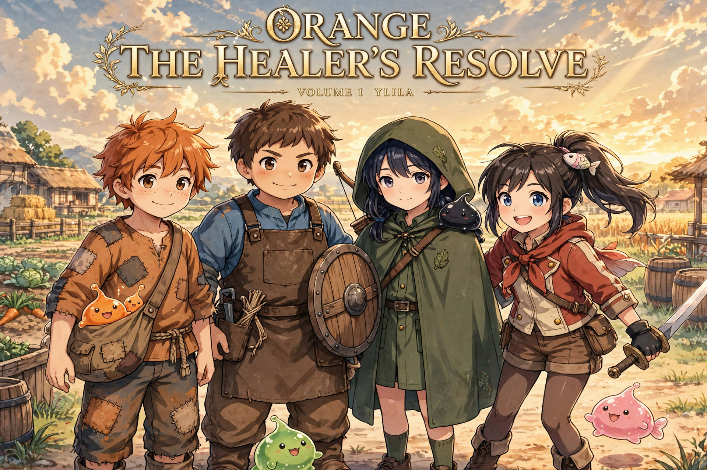
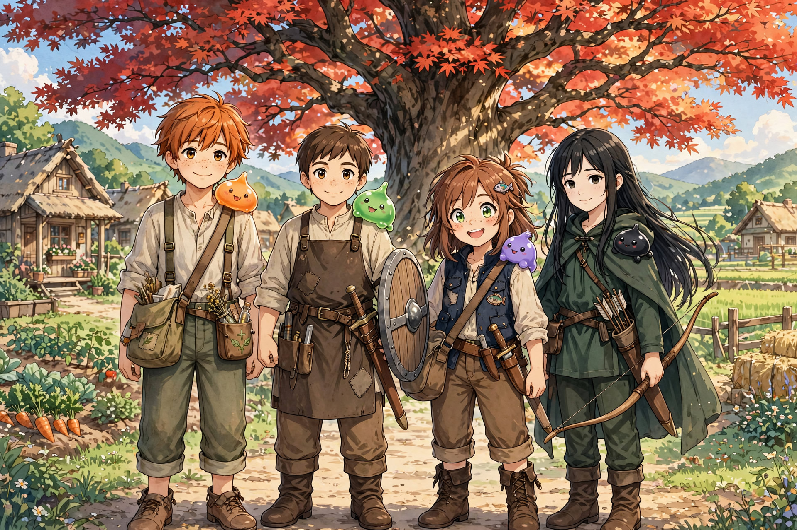
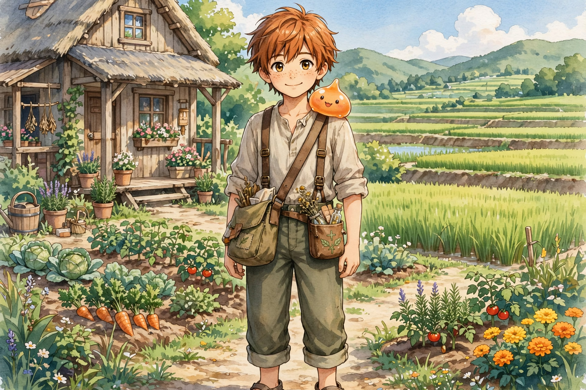
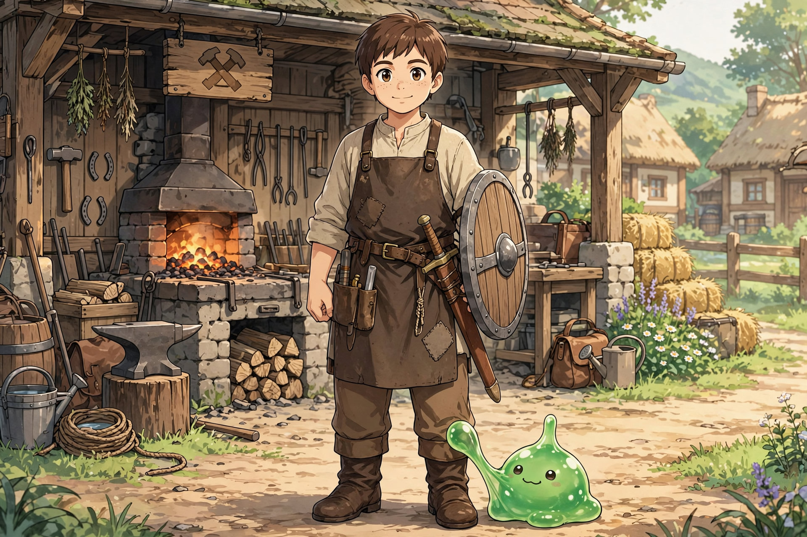
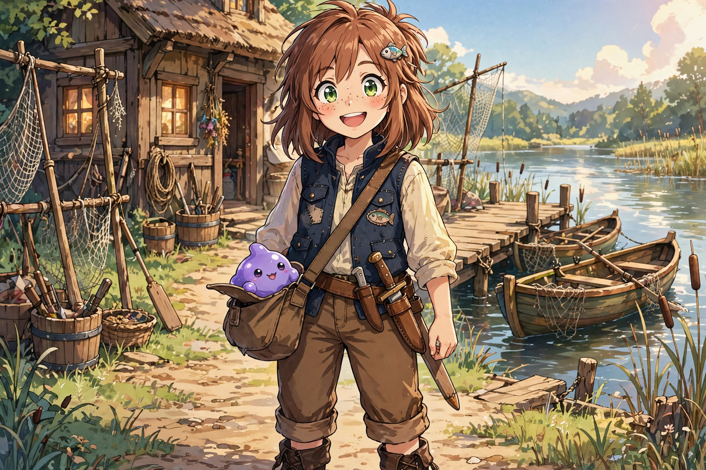
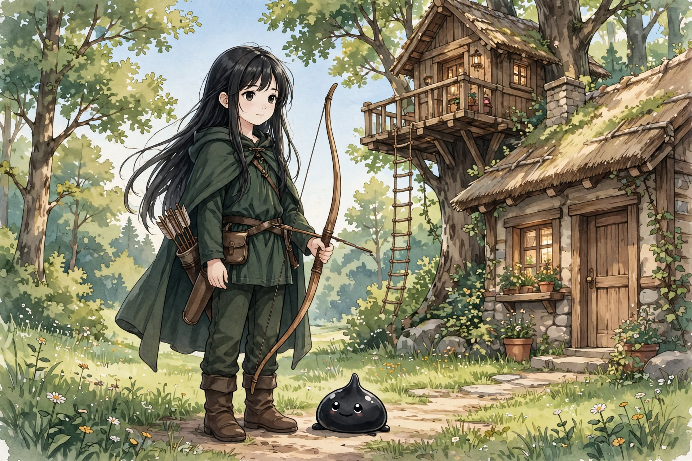

# Orange: The Healer's Resolve — Story Bible

A grounded medieval-fantasy light novel about Orange Oathkeeper, a young healer who can fight and kill but wins by making sure his team can. Set in Ylila, a small radial farming village of ~150 people, Volume 1 follows Orange, his slime partner Nochi, and their friends as slow, earned growth turns a peaceful village into a fortified safe haven. Volume 2 ends with the fall of Ember and the rise of Carrot Castle. Volume 3 is proposed as fields first.

Scope: Early World, Volumes 1–2 complete in draft, Volume 3 Fields First proposed.

> A place where people live properly… not perfectly.

> This is a story where strength is built, not given… and where even the strongest still need others.

Current group portrait is v2. Amy matches her lakeside solo: brown hair, jolly, standing with the group, purple fish hairpin.

## Main cast — main story ages

Main story is ages 12–13. Ages 8–10 appear in flashbacks only.

- [Orange Oathkeeper, 12, Jan 19](docs/characters/orange/orange-oathkeeper.md) — healer-support, short sword (Serra-trained basics, Pairo direction), with [Nochi](docs/characters/orange/nochi/nochi.md)
- [Leonard Leo Wardensmith, 13, Nov 7](docs/characters/leo/leo-wardensmith.md) — Fighter (Tank path, Warden-track), with [Greg](docs/characters/leo/greg/greg.md)
- [Amethyst Amy Ironheart, 12, Oct 8](docs/characters/amy/amy-ironheart.md) — Fighter (Sword path, Sword Dancer-track), with [Octo](docs/characters/amy/octo/octo.md)
- [Lyra Arroway, 12, Aug 25](docs/characters/lyra/lyra-arroway.md) — ghost archer (archer / scout / assassin, named from lyre; father plays lyre), kit 1 Heavy Draw / 2 Focus / 3 Multi Shot (Lv1 Double Strafe) / Ult Concentrate, with [Crow](docs/characters/lyra/crow/crow.md)
- [Serra, the Wild Healer](docs/characters/serra/serra.md) — mentor (Verdant Paladin), arrived Chapter 4 with Xavier (swordmage) and Ellinore “Eli” (dark-elf archer, Lyra’s same-path mentor)

Solo home portraits:

Slimes are iconic blobs. Semi-limb stretch is allowed. They are never humanoid, except Octo Stage 3. Team colors stay fixed: Nochi orange, Greg green, Octo purple, Crow black. Tendencies are SAS-driven comfort and movement, never attack spells; black is shadow only, no dark magic. Kingship is rare tier, any color; Ylila's Slime King happens to be blue after restoration. Sacred tree in Ylila is a maple.

## Contents

- [World Overview](docs/00-world-overview.md)
- [System Rules](docs/01-system-rules.md)
- [Conflict Engine + Progression](docs/02-conflict-engine.md)
- [Burden, Triage, Safe Haven](docs/03-healer-burden-triage-safehaven.md)
- [Ylila Village (Environment)](docs/world/ylila-village.md)
- [Ylila Village Map](docs/world/ylila-village-map.md)
- [Creatures & Ecosystem](docs/world/creatures.md)
- [Slime System (SAS Final Lock)](docs/world/slime-system.md)
- [Class Evolution System](docs/world/class-evolution.md)
- [Magic and Casting](docs/world/magic-system.md)
- [Stat System](docs/world/stat-system.md)
- [Adventurer Guild](docs/world/adventurer-guild.md)
- [Currency](docs/world/currency.md)
- [Village System: Scale, Places, Daily Life](docs/world/ylila-village-system.md)
- [Volume 1 Outline, Volume 2 direction, Volume 3 proposal](docs/story/volume1-outline.md)
- [Village Events](docs/story/village-events.md)
- [Combat & Training System](docs/story/combat-training-system.md)
- Characters (each folder holds its md, solo portrait, and Chapter Appearances):
  - [Orange Oathkeeper](docs/characters/orange/orange-oathkeeper.md)
  - [John Oathkeeper](docs/characters/john/john-oathkeeper.md)
  - [Marie Oathkeeper](docs/characters/marie/marie-oathkeeper.md)
  - [Serra — Verdant Paladin](docs/characters/serra/serra.md)
  - [Mentors of Ylila (hub)](docs/characters/mentors/mentors.md)
  - [Leonard Leo Wardensmith](docs/characters/leo/leo-wardensmith.md)
  - [Lyra Arroway](docs/characters/lyra/lyra-arroway.md)
  - [Amethyst "Amy" Ironheart](docs/characters/amy/amy-ironheart.md)
  - [Nochi — Orange's slime](docs/characters/orange/nochi/nochi.md)
  - [Crow — Lyra's slime](docs/characters/lyra/crow/crow.md)
  - [Greg — Leo's slime](docs/characters/leo/greg/greg.md)
  - [Octo — Amy's slime](docs/characters/amy/octo/octo.md)
- [Story Drafts (non-canon holding folder)](docs/story-draft/README.md)

## Locked Core Rules

- Food ≠ Power. Process = Power.
- Power comes from process, not talent alone.
- Skills are learned, not given.
- How you do the work shapes what the skill becomes (Skill Evolution).
- Growth is effort-based. No random spikes. No chosen one.
- Orange can fight and kill but is not the damage dealer. He wins by making sure his team can.
- Healing is not victory — it is responsibility.
- Priority is not fairness.
- Without Ylila, Orange will eventually break.
- Orange's cooking carries a growth signal (SAS = Symbiotic Adaptation System) — power that must be shared, never stolen. The older Grow-accident origin is rejected. Grey slimes are not current; Ylila's Slime King happens to be blue after restoration, but kingship is any-color rare tier. SAS slimes stay bonded partners, never tamed summons.
- Volume 1 caps: base classes only, short fragile channels, single-digit stats climbing slowly. Ylila registers base classes only.
- Leo starts Fighter and earns Warden; Warden is never a base class.
- Orange has affinity but still requires practice. His hybrid name stays unassigned and distinct from Serra.
- Early game: everyone starts simple before specializing.
- Balance is player-driven through finite points, never forced penalties: high STR never auto-slows casting, high DEX never auto-cuts durability.
- Every cast carries risk, timing, and consequence: no silent casting until mastered later, no instant high-tier magic.
- Orange's Buffs carry hidden +0.05% permanent growth visible at whole numbers; gains read as efficiency, never conjured power.
- Grow makes training cleaner so skills master faster and can evolve sooner; temporary window, high cost.
- Orange grows gradually within mana, stamina, and fatigue limits; late power stays late, hard-earned, and never Volume 1.
- Status windows are personal-only; slimes run on stored food energy with fatigue and cooldowns, transfer stays finite.
- The Guild rewards consistency: rank never equals power, no reward without proof, no instant promotion.
- Faith stays subtle early and translated, never forced; Orange is a bridge who heals and befriends. House of Restoration guidance grows later through Serra, by care first, words second.
- Dreams are rare symbolic guidance, sometimes only presence; guidance never replaces training.
- Orange's body path is gated: farm boy endurance first, self-healing tank mid, superhuman late, vessel endgame only.
- Presentation is modest and age-appropriate: practical covered dress, no fan service framing in novel, comic, or anime.
- Violence stays off-focus for people: enemy deaths happen off-frame or by implication; slimes incapacitate, never consume on the page.
- Team Carrot Juice wins the Ember castle battle. Kids stay sidelined as present, supporting, witnessing. Orange lands no deciding blow.
- Ember capital becomes Carrot City / Carrot Castle (CC) after conquest.
- Grow plus Heal burns corruption. This is established in Chapters Ten and Eleven and enables the Dark Knight fall.
- Mentors hold agency from Chapter 10 onward. They direct. Orange discovers within their frame.
- Schooling is basic theory-only (reading, numbers, lore, magic theory). No kid casting. Family work is the real training: farm, forge, wood, lake.
- Stat Favor (FAV) replaces CHA / Luck / Blessing.
- Slime tendencies are SAS-driven movement and comfort only, never attack spells. Temporary splits divide reserves while out, dry out if spent, return if mana remains.
- Kingship is rare any-color tier: very old, fed colony, abandoned-forest conditions, slime level 50. Overeat bare land like virus and they dry up; nourished land lets them rest. King Shell is the limiter: egg-like harden outside, moist inside, fully vulnerable, disturbed fails, never auto. No accidental kings in Volumes 1–3.

## Proposed next, not locked

- Ylila becomes a mini fortress-city first. Log walls plus tended farmland.
- Tended farmland acts as a work domain. It aids efficiency, recovery, and mastery while working. It grants no free stats.
- John anchors Ylila. Orange stays mobile between Ylila and Carrot Castle.
- Guild outpost grows toward a fuller branch. Second classes stay exam-gated. More jobs exist for people and bonded slimes.
- Carrot land-heal starts with survey. Orange, John, Slime King, and volunteers restore waterways and fields. Poison reads as symptom. True origin stays unknown.
- Ember generals split. One surrenders to keep order. One flees with loyalists. Third stays unnamed.
- Team stays 4 kids for now. No 5th hero yet. Distant schools, cults, guilds, and flight stay far-future notes only.

Parked detail: [Future Arcs (proposed, not locked)](docs/story/future-arcs-proposed.md).
