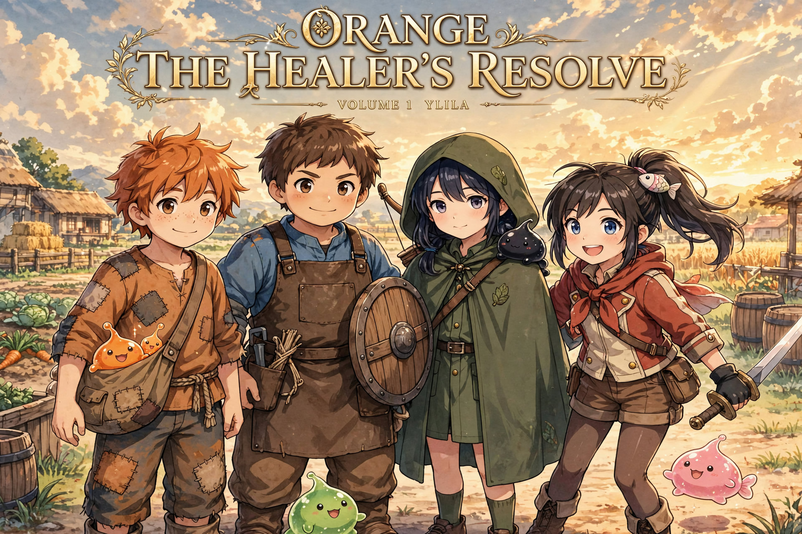
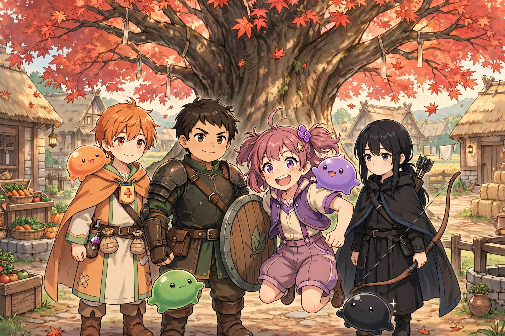
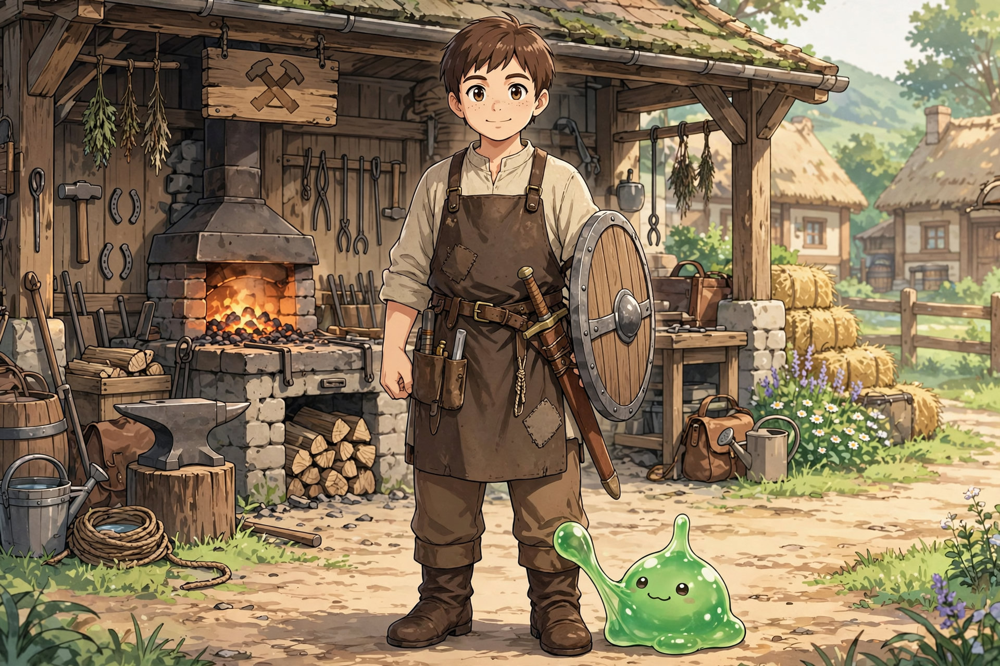
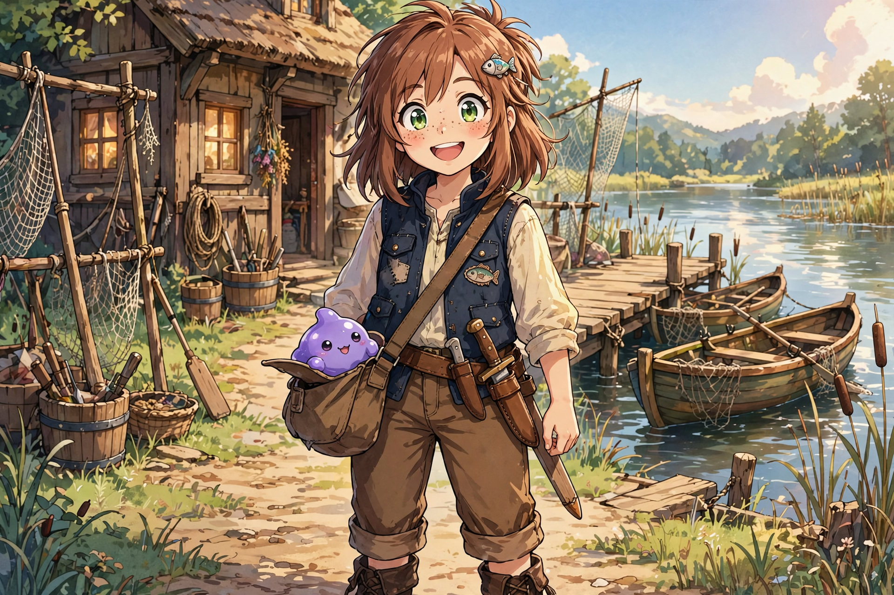

# Orange: The Healer's Resolve — Story Bible

A grounded medieval-fantasy light novel about Orange Oathkeeper, a young healer who never lands the killing blow — he makes sure his team can. Set in Ylila, a small radial farming village of ~150 people, Volume 1 follows Orange, his slime partner Nochi, and their friends as slow, earned growth turns a peaceful village into a fortified safe haven.

Scope: Early World, Volume 1 — Ylila Village Arc.

> A place where people live properly… not perfectly.

> This is a story where strength is built, not given… and where even the strongest still need others.

## Main cast — main story ages

Main story is ages 12–13. Ages 8–10 appear in flashbacks only.

- [Orange Oathkeeper, 12, Jan 19](docs/characters/orange/orange-oathkeeper.md) — healer-support, with [Nochi](docs/characters/orange/nochi/nochi.md)
- [Leonard Leo Wardensmith, 13, Nov 7](docs/characters/leo/leo-wardensmith.md) — tank, with [Greg](docs/characters/leo/greg/greg.md)
- [Amethyst Amy Ironheart, 12, Oct 8](docs/characters/amy/amy-ironheart.md) — sword dancer, with [Octo](docs/characters/amy/octo/octo.md)
- [Lyra Arroway, 12, Aug 25](docs/characters/lyra/lyra-arroway.md) — scout, with [Crow](docs/characters/lyra/crow/crow.md)

Solo home portraits:

Slimes are iconic blobs. Semi-limb stretch is allowed. They are never humanoid, except Octo Stage 3. Colors are locked: Nochi orange, Greg green, Octo purple, Crow black. Sacred tree in Ylila is a maple.

## Contents

- [World Overview](docs/00-world-overview.md)
- [System Rules](docs/01-system-rules.md)
- [Conflict Engine + Progression](docs/02-conflict-engine.md)
- [Burden, Triage, Safe Haven](docs/03-healer-burden-triage-safehaven.md)
- [Ylila Village (Environment)](docs/world/ylila-village.md)
- [Ylila Village Map](docs/world/ylila-village-map.md)
- [Creatures & Ecosystem](docs/world/creatures.md)
- [Village System: Scale, Places, Daily Life](docs/world/ylila-village-system.md)
- [Volume 1 Outline](docs/story/volume1-outline.md)
- [Village Events](docs/story/village-events.md)
- [Combat & Training System](docs/story/combat-training-system.md)
- Characters (each folder holds its md, solo portrait, and Chapter Appearances):
  - [Orange Oathkeeper](docs/characters/orange/orange-oathkeeper.md)
  - [John Oathkeeper](docs/characters/john/john-oathkeeper.md)
  - [Marie Oathkeeper](docs/characters/marie/marie-oathkeeper.md)
  - [Serra — Verdant Paladin](docs/characters/serra/serra.md)
  - [Leonard Leo Wardensmith](docs/characters/leo/leo-wardensmith.md)
  - [Lyra Arroway](docs/characters/lyra/lyra-arroway.md)
  - [Amethyst "Amy" Ironheart](docs/characters/amy/amy-ironheart.md)
  - [Nochi — Orange's slime](docs/characters/orange/nochi/nochi.md)
  - [Crow — Lyra's slime](docs/characters/lyra/crow/crow.md)
  - [Greg — Leo's slime](docs/characters/leo/greg/greg.md)
  - [Octo — Amy's slime](docs/characters/amy/octo/octo.md)

## Locked Core Rules

- Food ≠ Power. Process = Power.
- Power comes from process, not talent alone.
- Skills are learned, not given.
- How you do the work shapes what the skill becomes (Skill Evolution).
- Growth is effort-based. No random spikes. No chosen one.
- Orange does not win fights directly. He makes winning possible.
- Healing is not victory — it is responsibility.
- Priority is not fairness.
- Without Ylila, Orange will eventually break.
- Orange's cooking carries a growth signal (SAS) — power that must be shared, never stolen.
