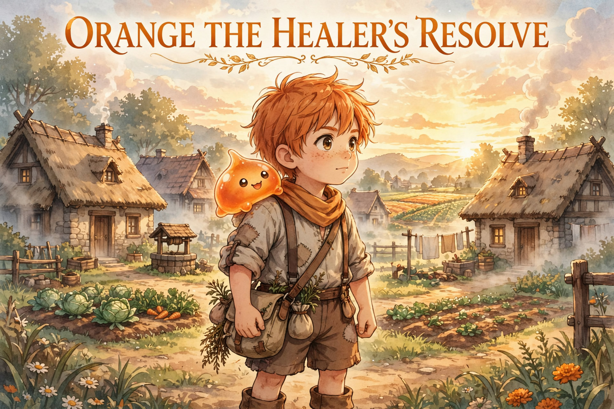

# Orange: The Healer's Resolve — Story Bible

A grounded medieval-fantasy light novel about Orange Oathkeeper, a young healer who never lands the killing blow — he makes sure his team can. Set in Ylila, a small farming village of ~50 families, Volume 1 follows Orange, his slime partner Nochi, and their friends as slow, earned growth turns a peaceful village into a fortified safe haven.

Scope: Early World, Volume 1 — Ylila Village Arc.

> A place where people live properly… not perfectly.

> This is a story where strength is built, not given… and where even the strongest still need others.

## Contents

- [World Overview](docs/00-world-overview.md)
- [System Rules](docs/01-system-rules.md)
- [Conflict Engine + Progression](docs/02-conflict-engine.md)
- [Burden, Triage, Safe Haven](docs/03-healer-burden-triage-safehaven.md)
- [Ylila Village (Environment)](docs/world/ylila-village.md)
- [Volume 1 Outline](docs/story/volume1-outline.md)
- Characters (each folder holds its md, solo portrait, and Chapter Appearances):
  - [Orange Oathkeeper](docs/characters/orange/orange-oathkeeper.md)
  - [John Oathkeeper](docs/characters/john/john-oathkeeper.md)
  - [Marie Oathkeeper](docs/characters/marie/marie-oathkeeper.md)
  - [Serra — Verdant Paladin](docs/characters/serra/serra.md)
  - [Leonard Leo Wardensmith](docs/characters/leo/leo-wardensmith.md)
  - [Lyra Arroway](docs/characters/lyra/lyra-arroway.md)
  - [Nochi — Orange's slime](docs/characters/orange/nochi/nochi.md)
  - [Crow — Lyra's slime](docs/characters/lyra/crow/crow.md)
  - [Greg — Leo's slime](docs/characters/leo/greg/greg.md)

## Locked Core Rules

- Food ≠ Power. Process = Power.
- Power comes from process, not talent alone.
- Skills are learned, not given.
- Growth is effort-based. No random spikes. No chosen one.
- Orange does not win fights directly. He makes winning possible.
- Healing is not victory — it is responsibility.
- Priority is not fairness.
- Without Ylila, Orange will eventually break.
