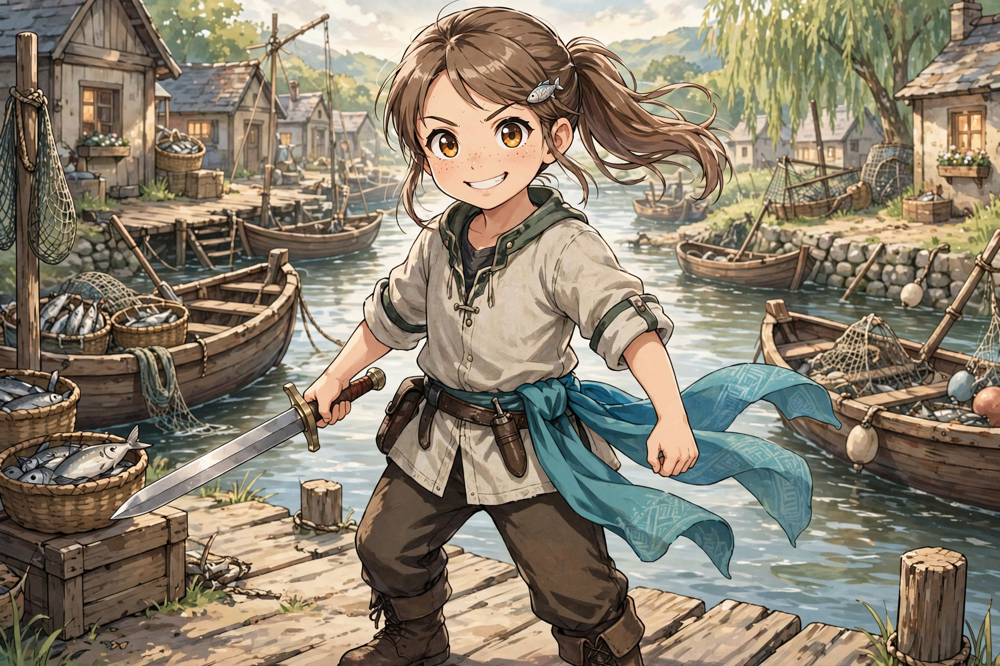

# AMETHYST “AMY” IRONHEART (FINAL, UPDATED)

**Role:** Damage Dealer / Close-Range Aggressor / Flow Combat Specialist
**Archetype:** The Sword Dancer

Partner slime: [Octo](octo/octo.md) — full Octo system also kept in Octo's own folder.

---

## CORE IDENTITY (LOCKED)

Amy is:

* the striker
* the pressure maker
* the one who breaks openings

---

✔ She pushes forward
✔ She creates momentum

---

> “If there’s a way through… I’ll make one.”

---

---

## CHARACTER FOUNDATION

### Personality:

* energetic
* expressive
* competitive
* emotionally driven

---

✔ acts fast
✔ learns control over time

---

---

## FAMILY INFLUENCE (FINAL LOCK)

---

### **Steve — Fisherman (Spear + Knife User)**

* uses **trident/spear** for fishing
* uses **knife** for filleting and preparation
* works with precision and efficiency

---

Teaches Amy:

✔ **positioning logic** (distance, entry timing)
✔ **when to strike** (not just how)
✔ **precision cutting**
✔ **efficiency — no wasted motion**

---

> “Don’t rush in.
> Wait… then cut.”

---

---

### **Naomi — Dancer**

* graceful movement
* rhythm and balance

---

Teaches Amy:

✔ **how to move**
✔ **how to flow between actions**
✔ **how to stay balanced under pressure**

---

---

### **Shared Learning (Cooking with Steve)**

Amy learns:

* filleting
* slicing
* chopping

---

Builds:

✔ hand precision
✔ control of force
✔ repetition discipline

---

---

## CORE COMBAT FORMULA (LOCKED)

---

Amy is a fusion of:

### Positioning (Father)

### Movement (Mother)

### Precision (Cooking)

---

---

## CORE MECHANIC (LOCKED)

---

> ❗ Amy does not win by brute force
> ✔ She wins by **flow + timing + precision**

---

---

## PASSIVE SKILL (LOCKED)

### **Dancer’s Flow**

---

### Effects:

* smoother movement
* reduced stamina cost while in motion
* better balance during attacks

---

---

### Hidden Effect:

* natural combo chaining
* harder to predict

---

> “She doesn’t stop… she flows.”

---

---

## SECONDARY TRAIT (LOCKED)

### **Butcher’s Precision**

---

* instinctively targets weak points
* reduces wasted strikes
* increases efficiency

---

---

## COMBAT STYLE

---

### Early:

❌ overcommits
❌ wastes stamina
❌ emotional attacks

---

---

### Developed:

✔ controlled aggression
✔ precise strikes
✔ continuous flow

---

---

## CLASS EVOLUTION

### **Sword Dancer**

---

✔ fluid attack chains
✔ rhythm-based combat
✔ high-speed precision

---

---

> “Every step leads to a strike.
> Every strike leads to the next.”

---

---

## SLIME PARTNER SYSTEM -- Octo (FINAL LOCK)

---

### Nature:

* expressive
* adaptive
* responds to Amy’s intent

---

---

## STAGE 1: **Blade Extension (Flow Assist)**

---

* slime extends along weapon

---

✔ increased reach
✔ smoother strikes
✔ better hit connection

---

---

## STAGE 2: **Kraken Flow (Extension Pressure)**

---

* slime extends like multiple limbs

---

✔ multi-angle attacks
✔ pressure from unexpected directions

---

---

## STAGE 3: **Partner Dance (CORE IDENTITY)**

---

* slime separates and fights beside Amy

---

✔ synchronized combos
✔ dual-pressure offense
✔ continuous chaining

---

---

> “She doesn’t fight alone…
> she dances with it.”

---

---

## STAGE 4: **Unleash the Kraken (Burst Mode)**

---

* slime becomes independent combat unit
* aggressive multi-strike behavior

---

✔ overwhelming offense
✔ chaotic pressure

---

---

### Limitation:

* drains slime energy
* requires recovery (or Orange’s cooking buffs)

---

---

## COMBAT PHILOSOPHY

---

Amy fights to:

* overwhelm
* pressure
* break enemy structure

---

---

### Key Principle:

> “Don’t let them recover.”

---

---

## RELATIONSHIP WITH ORANGE

---she has a liking of orange--

Amy benefits from:

✔ **Grow → massive combo spike**
✔ **Status Up → sustained aggression**

---

---

### Result:

* high burst potential
* fight-finishing capability

---

---

## TEAM FUNCTION

---

Amy enables:

✔ breaking enemy lines
✔ creating openings
✔ finishing targets

---

---

## LIMITATIONS

---

Amy:

❌ low durability
❌ vulnerable if overextended
❌ depends on maintaining flow

---

---

✔ Weakness:

* if rhythm breaks → effectiveness drops

---

---

## SYMBOLISM

---

Amy represents:

* emotion in motion
* expression through combat
* freedom shaped by discipline

---

---

> “She doesn’t just fight…
> she moves like she means it.”

---

---

## FINAL LOCK STATEMENT

---

Amy Ironheart is not built to endure—

---

She is built to:

✔ move
✔ strike
✔ overwhelm

---

---

> Leo holds the line.
>
> Amy breaks it.

---

---
likes to wear a hairpin on the right

---

## FLOW BREAK SYSTEM (LOCKED)

Amy's performance depends on maintaining rhythm.

---

### When Flow Breaks:

* movement becomes inefficient
* attacks lose precision
* stamina consumption increases

---

### Causes:

* missed timing
* blocked attacks
* forced interruption
* emotional hesitation

---

### ❗ Core Rule:

> Once her flow breaks—
> she must reset before becoming effective again.

---

## ENTRY CONDITION (LOCKED)

Amy performs best when entering through:

✔ created openings
✔ guided timing (Lyra)
✔ safe space (Leo)

---

### ❗ Core Rule:

> Entering without setup increases risk of overextension.

---

## EMOTIONAL SPIKE (LOCKED)

Amy's emotional state affects her combat flow.

---

### Positive:

* determination → stronger chaining
* trust → smoother coordination

---

### Negative:

* frustration → rushed attacks
* fear → hesitation (flow break risk)

---

### ❗ Core Rule:

> Emotion fuels her—
> but can also disrupt her rhythm.

---

## TRUST LINK — ORANGE (LOCKED)

Amy commits fully when supported by Orange.

---

### Behavior:

* pushes deeper into fights
* risks extended combos
* relies on timing of buffs/heals

---

### ❗ Core Rule:

> She fights harder—
> because she believes he will keep her going.

---

## SIGNATURE HABIT (LOCKED)

Before engaging:

* adjusts hairpin (right side)
* shifts stance lightly
* eyes lock on target

---

### Meaning:

✔ focus
✔ readiness
✔ commitment to action

---

> ❗ When she touches her hairpin—
> she's about to move.

**END OF SYSTEM LOCK**

---

## Chapter Appearances

### Chapter 1

## Root Passive (Locked)

Dancer's Instinct: natural rhythm in movement — smoother footwork, better balance, faster directional changes. Combat: easier dodging, fluid attack chaining, harder to predict. Hidden: reduces stiffness in combat, allows continuous motion. Growth: Dancer's Instinct → Flow State → Sword Dance. Identity: "She doesn't fight… she flows." Bridges mom (dance), dad (blade), future class.

### Chapter 2 — Party Intro

