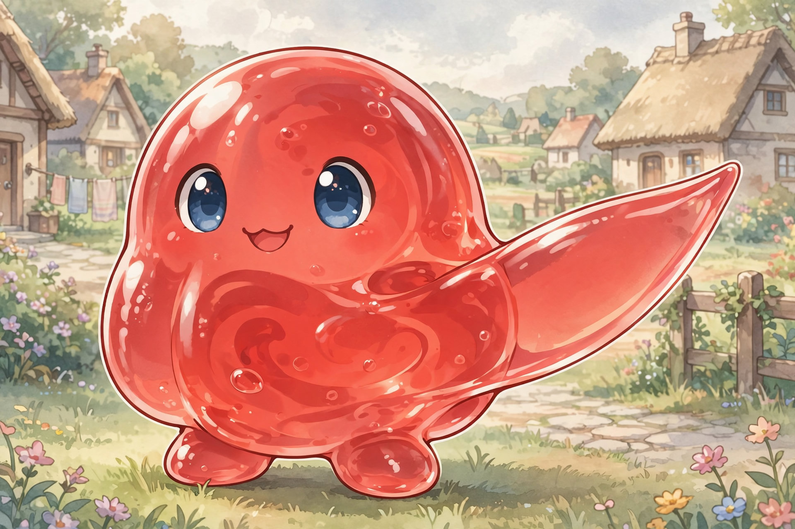

# Octo — Slime Partner of Amy (FINAL LOCK)

Partner of [Amethyst "Amy" Ironheart](../amy-ironheart.md). Expressive, adaptive, responds to Amy's intent. Color: coral-red (provisional — confirm).

## STAGE 1: Blade Extension (Flow Assist)

Slime extends along weapon. Increased reach, smoother strikes, better hit connection.

## STAGE 2: Kraken Flow (Extension Pressure)

Slime extends like multiple limbs. Multi-angle attacks, pressure from unexpected directions.

## STAGE 3: Partner Dance (CORE IDENTITY)

Slime separates and fights beside Amy. Synchronized combos, dual-pressure offense, continuous chaining.

> She doesn't fight alone… she dances with it.

## STAGE 4: Unleash the Kraken (Burst Mode)

Slime becomes independent combat unit, aggressive multi-strike behavior. Overwhelming offense, chaotic pressure.

### Limitation:

Drains slime energy, requires recovery (or Orange's cooking buffs).

## Limitation (Shared Slime Rule)

Cannot create energy. Only stores, redistributes, enhances efficiency. Extends sustainability, not power.

## Chapter Appearances

### Chapter 1

