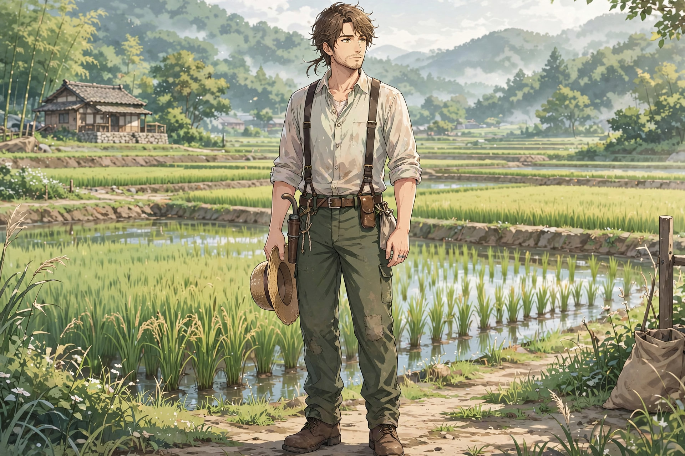
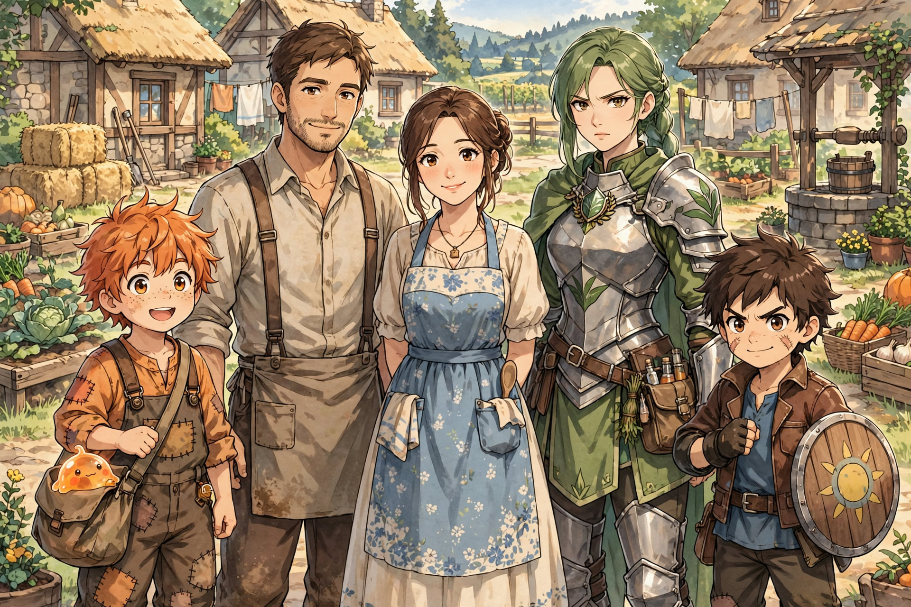

# John Oathkeeper — Father / Village Pillar

Archetype: The Reflective Builder.

> Effort without reflection is wasted. Effort with purpose builds something lasting.

## Role in Ylila

Harsh plain, low yield — yet John's land thrives via soil understanding, consistent care, refined methods. Main supplier of high-quality rice. Reason Ylila sustains itself.

> Where others struggle to grow… he makes it work.

## Personality

Calm, thoughtful, observant, intentional. Reflects, evaluates, improves.

Passive: Enduring Body — high stamina, reduced fatigue. Hidden: efficiency improves through repetition.
Trait: Reflective Mind — "What happened? What could we do better? Did we do our best?"

## Family Dynamic

Regular sit-down reflections, solo and family. Teaching: DOES lecture and guide intentionally, grounded and constructive. Steps: reflect, identify improvement, reinforce best, guide future.

Key lines: "Orange, I am happy that you are my son. You are truly loved." / "I am proud of you. Keep doing your best." / "Did we do our best?" / "Next time, we do it better."

Mentorship: find good mentors, avoid bad practices, learn properly. "Don't just copy what works — understand why it works." Excellence expected, laziness not accepted.

Influence on Orange: discipline, stamina, reflection, growth mindset. Orange learns how to improve.

## Response to Failure (Locked)

No shame, no blind comfort. 1. Acknowledges effort. 2. Clarifies reality. 3. Redirects. "You did your best… but something was lacking. Let's find it." Separates effort from outcome, demands growth.

## Farming as Philosophy

Soil = foundation. Water = consistency. Sun = timing. Harvest = results. "You cannot rush growth. You can only prepare for it properly."

## Limitation

Limited combat/healing understanding. Advice incomplete in extremes. Builds foundation but cannot walk every path with Orange.

## Signature Habit

Pauses, looks at field/ground/sky, breathes, then speaks. Silence is part of wisdom.

## Presence Effect (Locked)

John does not need to raise his voice. People straighten posture around him, excuses feel weak, effort naturally increases.

> John does not demand excellence — his presence makes people want to meet it.

> He didn't give Orange power. He taught him how to build it — and use it well.

## Chapter Appearances

### Chapter 1

