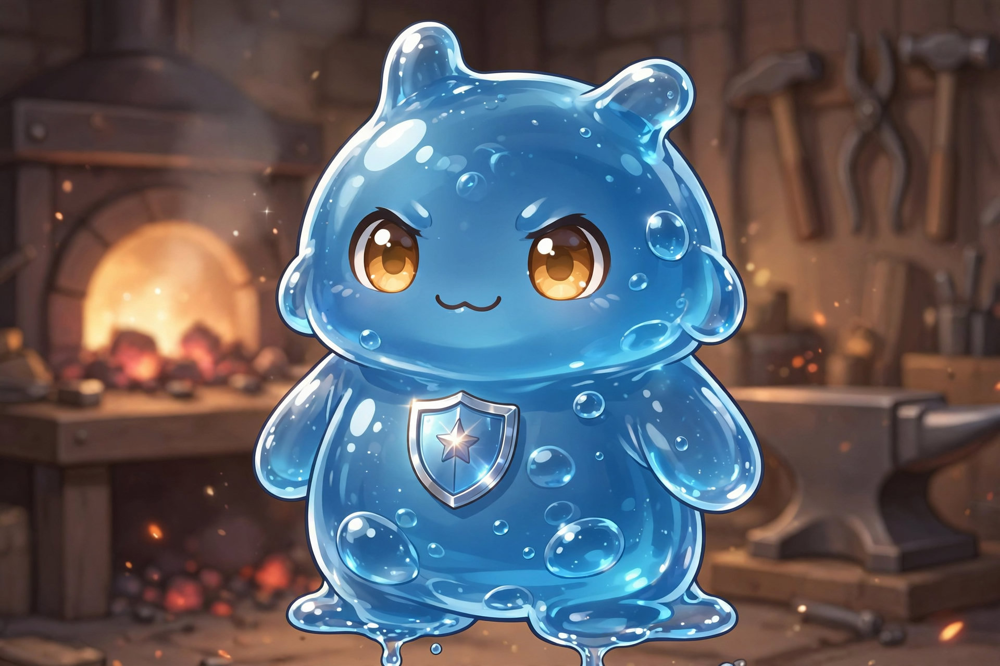

# Greg — Slime Partner of Leo (Locked)

Partner of [Leonard Leo Wardensmith](../leo-wardensmith.md). Protective, adaptive, synergizes with armor. Color: green (locked).

## SLIME DESIGN RULE (LOCKED)

Iconic slime form: classic droplet blob. May stretch semi-limb extensions, never humanoid in shape — no legs, no standing body.

## Evolution Path (FINAL LOCKED VERSION)

### STAGE 1 — Armor Sync (Foundation)

Slime reinforces from underneath. Impact absorption, stance stabilization, reduced recoil. Simple, efficient, always useful.

> “You hit me… but it doesn't land right.”

### STAGE 2 — Full Engulf (Size + Defense)

Slime expands and engulfs Leo. Increases size (teen → adult build), thicker armor layer, higher physical + magical resistance. Heavier presence, harder to move, harder to damage.

> “I become the armor.”

Balance: slower movement, higher stamina cost. First real power spike.

### STAGE 3 — Engine Mode (Signature Form)

Slime + armor = mechanized system. Compresses into tight, efficient armor. Enhances jump force, forward bursts, strike impact.

KEY FEATURE (LOCKED) — Forearm Shield System: expands outward for wide defense, compresses inward into a dense striking weapon. Combat use: block → counter, shield bash → stun, leap → pressure.

> “Heavy… but fast when it matters.”

Balance: requires control, inefficient if spammed, drains slime gradually. Leo's true fighting form.

### STAGE 4 — Juggernaut Mode (Ultimate)

Engine Mode overdrives into giant form. Grows to ~3 meters or more. Massively increased durability, strength, presence. Ground-and-pound attacks, shockwave impact, area pressure. Mobility twist: can super jump despite size.

> “Run… or get crushed.”

CRITICAL BALANCE (LOCK HARD): short duration, heavy slime drain, leaves Leo slowed after, vulnerable once it ends. Last resort requiring Orange + Nochi recovery.

### Final Evolution Flow

1. Armor Sync → stability
2. Full Engulf → size + defense
3. Engine Mode → control + impact
4. Juggernaut Mode → domination

### Final Lock Summary

No random abilities, no magic gimmicks. Pure armor, force, control. Each stage feels different, with strong identity per stage and synergy with his parents (design + function).

## Limitation (Shared Slime Rule)

Cannot create energy. Only stores, redistributes, enhances efficiency. Extends sustainability, not power. Volume 1 gate: wall now, Engine / Juggernaut late.

## Team Role Note

Leo now does TWO things: holds the line, and breaks enemy formation. Team: Orange = Support Engine, Leo = Battlefield Anchor / Breaker, Amy = Close-range Pressure, Lyra = Hidden Execution.

## Engulf Flavor (Locked)

Early on, the small green slime grows bigger mid-fight, then eats Leo — not hurting him, just making him slimy. SAS does its job; afterward the team goes "ugghh, your slime is definitely strangely attached to you." Leo loves his slime but doesn't like being swallowed and engulfed to attach — at least at first. Later the slime simply slides into full-body armor coating.

## Chapter Appearances

### Chapter 1

