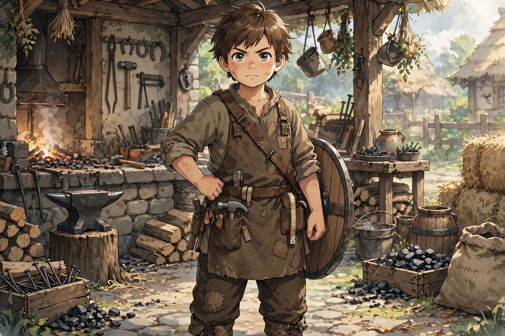

# Leonard Leo Wardensmith — Tank / Frontline Anchor

Main-story age lock: 13 (birthday November 7). Flashbacks at 8–10 only.

Archetype: The Unbreakable Builder.

Partner slime: [Greg](greg/greg.md).

> If I don't move… no one gets through.

## Foundation

Bold, straightforward, dependable, quietly intelligent. Appears simple, observant and adaptive.

Family: Ethan Wardensmith (blacksmith, structure/durability/function). Nathaly Wardensmith (artisan, form/balance/harmony).

Passive: Innovative Mind — improves equipment use, adapts tools. Hidden: function + design synergy. "This could work better…"

## Combat Role

Frontline tank, space controller, damage absorber. Holds attention, protects allies, creates safe zones.

Defense strong, stable, excellent shield. Offense early weak: overcommits, openings, slow recovery. Shifts long sword → short weapon (hammer/short sword), shield bash only, chooses control over power.

> Leo does not win by damage. He wins by endurance + control.

Future Engine/Juggernaut gated to late story. Volume 1 = wall, not weapon.

## Hold vs Retreat (Locked)

Instinct holds; Orange may call retreat. Trust must be earned. Learns when holding is strength vs liability.

## Pain Tolerance

Fights injured, delays damage reaction. Risk: ignores critical damage, collapses suddenly.

## Adaptation

Adjusts grip, shield angle, stance. Defense is not static. Block/parry redirect creates openings. Defense creates offense. "Wait for it… now." Enables Amy, Lyra timing.

## Juggernaut Limitation

Last resort, not standard. Extreme drain, limited duration, post-use vulnerable, needs Orange + Nochi recovery.

## Protective Instinct

"If someone's getting hit — it should be me." Learned from protective father. Learned responsibility, not just instinct.

## Work Ethic + Competitive Link

Blacksmithing + farming build durability. "If I can carry this… I can hold that." Sees Orange as effort standard, must endure smarter without regeneration. Learns to optimize, not just match.

## Gear Habit + Weapon Path

Constantly checks straps, curve, balance. "This feels off… I can fix it." Experiments long → short → shield-integrated. Equipment is part of fighter.

Likes Lyra quietly. Prepares gear with her in mind (future compound bow). Indirect, through actions.

Signature: plants foot, lowers center, tightens shield. Once set — intends to stay.

> Orange keeps the team alive. Leo makes sure they have something to stand behind.

## Final Rework — Engineer Tank Path (Locked)

True identity: Tank → Warden → Juggernaut Engineer. Not just a tank.

Hidden trait (NEW): observant, practical, mechanically curious. Early: notices how shields absorb impact, experiments with grip and angles, adjusts stance naturally. Later: full engineer mindset.

Function (father Ethan, blacksmith: tools, weapons, structural metal) + Form (mother Nathaly, artisan: accessories, engravings, armor aesthetics) = Innovation (Leo).

Slime as living mana engine: Early — messy, awkward engulf; boosts damage absorption, corrosion resistance. Mid — slime interacts with gear: fills armor gaps, reinforces weak points, stabilizes impact. Advanced — BIO-MECHANICAL ARMOR SYSTEM: hybrid metal + living slime; absorbs impact and redistributes force, stores energy and releases it on movement, turns weight into controlled power. Result: not just tanking… bulldozing.

Nathaly's role (CRUCIAL): Leo's Gear Designer. Early: fixes straps, adjusts shield balance, decorates gear. Mid: designs layered armor, joint flexibility, weight distribution. Late: designs around the slime — from "armor that fits Leo" to "armor that works WITH slime."

SAS for Leo (LOCK): Symbiotic Armor System — Slime = power source, Armor = structure, Leo = controller. (His instance of the wider Symbiotic Adaptation System.)

Juggernaut final form: slime fully integrated, armor expands and adapts, momentum builds power. Unstoppable forward movement, impact shockwaves, terrain-breaking charge. Balance: insane durability and frontline dominance, but heavy, slower turns, relies on setup, vulnerable if the slime is disrupted.

Character depth: stubborn tank, secretly smart, builder and creator.

## Profile — Revised (Locked)

Basic info: Leonard "Titan", age 13, Human. Fighter (Tank Path, early noob stage).

Class direction: starts sword + shield, gradually drops sword usage, focuses on defense. Future path: Fighter → Defender → Warden → Guardian → Titan ("Titan" becomes both title and identity later). Hammer as sub-weapon later.

Combat identity: shield = main weapon. Style: absorb → hold → counter.

Weaknesses (LOCKED, do not change): not very fast, takes hits even when unnecessary, emotionally stubborn.

Contrast role: Leo keeps the shield and becomes immovable (stability); Amy drops hers and becomes fluid (movement).

## Profile (Locked)

Basic info: Leonard Wardensmith, age 13, Human. Warden (Tank). (Note: "Titan" is his future title, not surname. "Ironheart" was an early surname — discarded.)

Personality: steady and reliable. Hidden: feels responsible to protect others even at his own cost. Quirk: complains about his slime… but secretly cares about it.

Motivation: become someone who can stand at the front and never fall.

Relationships: Orange — best friend, rival in effort, trusts him with his life. Lyra — finds her attractive but doesn't understand why he gets awkward.

Abilities: high endurance, shield defense; future growth into crowd control, shockwave attacks, Guardian path. (Hammer stays a later sub-weapon per engineer rework.)

Role: frontline defense, damage absorber, anchor of formation.

Sample lines: "Stay behind me." / "If it's coming through—I'm stopping it."

## Chapter Appearances

### Chapter 1

## Passive Growth (Locked)

Innovative: sees how things work and improves them — adjusts grip and stance, cuts wasted movement, better equipment handling. Combat: better shield angles, faster recovery after blocking, efficient energy use. Non-combat: modifies tools, improves designs, spots gear flaws. Growth: Innovative → Adaptive Builder → Combat Engineer. Identity: "There's always a better way to do it." Supports future blacksmith, engineered armor, SAS integration.

### Chapter 2 — Party Intro

