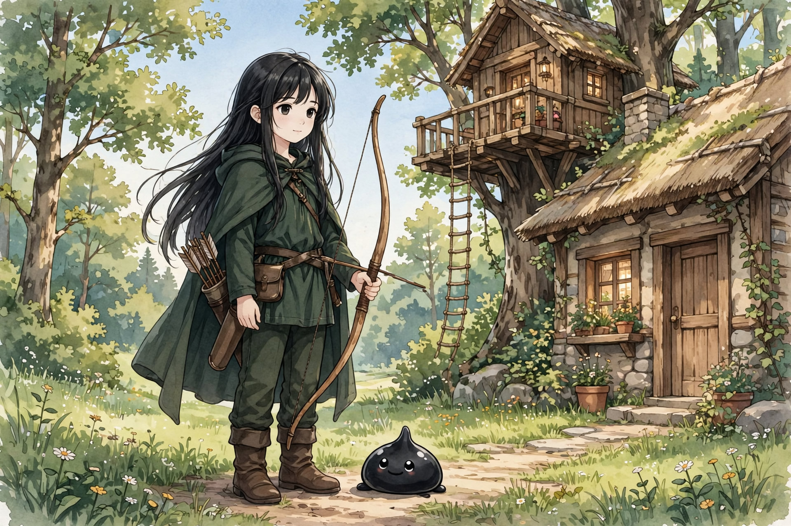
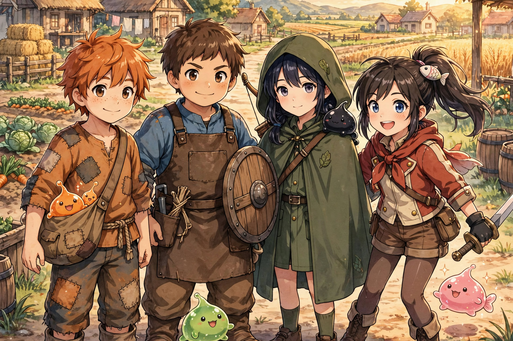

# LYRA ARROWAY (FINAL, COMPLETE — INTEGRATED)

Main-story age lock: 12 (birthday August 25). Flashbacks at 8–10 only.

Role: Long-Range Damage / Scout / Battlefield Controller
Archetype: The Silent Observer / Assassin

Partner slime: [Crow](crow/crow.md) — full Crow system also kept in Crow's own folder.

---

## CORE IDENTITY (LOCKED)

Lyra is:

* the watcher
* the one who sees first
* the one who strikes unseen

✔ She does not rush
✔ She does not waste movement

> “You don’t find her…
> she finds you.”

---

## CHARACTER FOUNDATION

Personality:

* quiet
* observant
* patient
* focused

✔ speaks less
✔ notices more

---

## FAMILY INFLUENCE (FINAL LOCK)

---

### Vincent Arroway — Carpenter (FINAL)

Builder of structure, precision through craft. Carpenter (houses, furniture, tools, bows). Repairs village structures.

Skills: precise measurement, steady hands, material understanding (wood tension, balance), crafting bows and arrow shafts.

Passive: "Steady Hand" — improved control in fine movements, better alignment and balance.

Personality: patient, detail-oriented, practical.

Relationship with Lyra — teaches her how to hold tools, how to align properly, how to "feel" balance. Teaching style: "If it's crooked, fix it." "Measure twice." "Don't rush your hands."

Influence on Lyra: aim stability, hand control, precision.

Hidden detail: Lyra learned balance from carrying wood, alignment from helping build, patience from watching her dad work. She didn't train to be an archer. She grew into one.

---

### Silk Arroway — Forager & Tailor (FINAL)

Talented twice over: gathers and forages the wilds, and tailors what she finds. Moves naturally through terrain — her silence comes from understanding how fabric moves with grace in its surroundings. She likes to dance.

Skills: quiet movement, climbing, terrain navigation, plant gathering, fine tailoring, fiber and string selection for bows.

Passive: "Soft Step" — reduced sound, minimal disturbance.

Mastery: not a sword dance but the gracefulness and footing of dancing like fabric — like her name says. Like silk: soft, smooth, and delicate.

Influence on Lyra: stealth, movement, terrain flow — and the idea that grace itself is a skill.

---

## CORE EQUIPMENT IDENTITY

Lyra’s bow is crafted from:

✔ perfect wood (father) → stability
✔ perfect string (mother) → tension control

RESULT:

✔ consistent shots
✔ stable draw
✔ precision under pressure

---

## PASSIVE SKILL (LOCKED)

### Nature Walk (FINALIZED ORIGIN)

Now comes from — Father: steady aim, controlled hands, precision. Mother: silent movement, terrain mastery, balance.

RESULT: Precision + Movement = Natural Flow in Terrain.

Effects: reduced terrain penalty, stable footing while aiming, smoother repositioning, better environmental awareness. Hidden: instinctive positioning advantage.

> “She’s already where she needs to be.”

---

## COMBAT ROLE (LOCKED)

Lyra is:

✔ long-range damage dealer
✔ scout
✔ battlefield controller

Core Function:

* gather information first
* secure position
* eliminate priority targets

---

## COMBAT STYLE

✔ Strengths:

* patience
* accuracy
* awareness
* positioning

❌ Weakness:

* vulnerable if exposed
* requires setup

---

## CORE MECHANIC (LOCKED)

❗ Lyra does not win by speed
✔ She wins by seeing + predicting + positioning

---

## SHOT DISCIPLINE (LOCKED)

Lyra only fires when:

* target is confirmed
* position is stable
* outcome is meaningful

❗ Core Rule: Every arrow must change the fight.

---

## CONTROLLED BARRAGE SYSTEM (LOCKED ADDITION)

### CORE ADJUSTMENT (VERY IMPORTANT)

❗ Early Lyra does NOT rely on perfect shots. ✔ She uses volume to compensate for inconsistency.

### EARLY COMBAT BEHAVIOR (NEW — LOCK THIS)

Instinctive Barrage — when target moves unpredictably, pressure is high, aim not yet stable:

* fires multiple arrows in succession
* prioritizes area denial over accuracy
* creates pressure instead of clean kills

Purpose: compensate for inexperience, force enemy movement, buy time for team.

> “If one won’t land… send more.”

### EARLY LIMITATIONS (IMPORTANT)

Stamina drain increases quickly, accuracy drops further with panic, wastes arrows and resources.

❗ Core Rule: Barrage is inefficient— but necessary early.

### TRANSITION PHASE (GROWTH POINT)

As Lyra improves: pattern recognition increases, positioning improves, confidence stabilizes.

Result: fewer arrows needed, higher hit rate, more intentional shots.

### MID-LEVEL STYLE (REFINED CONTROL)

Controlled Barrage — used when covering allies, forcing enemies into position, creating openings for Amy or Leo:

* short, targeted volleys
* directional pressure
* intentional misses to guide enemy movement

> “Move where I want… or get hit.”

### ADVANCED STYLE (TRUE IDENTITY)

Precision Dominance: single-shot eliminations, minimal movement, maximum impact.

❗ Final Rule: She doesn't shoot less because she can't— she shoots less because she doesn't need to.

### TACTICAL USE CASES (IMPORTANT FOR STORY)

Cover Fire (protect retreat, suppress advance), Advance Support (force enemies to defend, create safe path for Amy and Leo), Disruption (break enemy rhythm, interrupt casting and skills).

### SYNERGY WITH TEAM (UPDATED)

With Orange: barrage buys time for decisions; later precision enables Grow optimization. With Leo: covers blind spots, reduces frontline pressure. With Amy: forces enemy movement, creates predictable openings.

### SYNERGY WITH CROW (IMPORTANT ADDITION)

Early: barrage compensates for incomplete info. Later: Crow identifies target, Lyra stops barrage, switches to precision OR Execution Crow.

❗ Core Evolution: Barrage → Information → Precision → Execution.

### FINAL INTEGRATION STATEMENT

Lyra does not start as a perfect sniper— she starts as someone who shoots more to make up for what she lacks, learns through repetition, refines every shot over time.

At first, she fills the field with arrows. Later… she only needs one.

---

## ATTACK SYSTEM (COMPLETE — LOCKED)

1. Scatter Shot (EARLY CORE): rapid firing of multiple arrows for low-accuracy situations, suppression, buying time. Area denial, forces movement. Limitation: stamina drain, low efficiency.

> “If one won’t land… send more.”

2. Pinning Shot: aimed shot to restrict movement — legs, joints, pathing direction. Slows enemy, locks position briefly.

> “Don’t move.”

3. Guiding Volley (CONTROL PHASE): controlled barrage, not random. Forces enemies into position, guides them into Leo and Amy range. Battlefield shaping, directional pressure.

> “Go where I want… or get hit.”

4. Precision Shot (CORE IDENTITY): single, fully committed shot. Requires stable position, confirmed pattern, clear opening. High accuracy, decisive impact.

❗ Rule: One shot must matter.

5. Silent Mark (SETUP SKILL): observes target without firing. Identifies pattern, improves next shot accuracy, enables Execution Crow.

❗ Core Rule: She earns the right to shoot.

---

## COMPLETE COMBAT LOOP (VERY IMPORTANT — LOCKED)

1. Observe (Crow + Lyra)
2. Analyze (patterns, weaknesses)
3. Control (Scatter / Guiding Volley)
4. Position (Nature Walk + movement)
5. Decide (Precision Shot OR Execution Crow)

❗ FINAL RULE: Lyra does not react to the fight— she shapes it before acting.

---

## SKILL SET (FINAL — REFINED)

### Passive Skill

Nature Walk: reduced terrain penalty, silent movement, better positioning. Always active. Foundation of her playstyle.

### Core Active Skills — Ghost Archer order: 1 Heavy Draw, 2 Focus, 3 Multi Shot, Ult Concentrate

1. Heavy Draw / Charge Arrow (Active, Power): hold for a deeper draw. Flatter flight, harder hit. Needs stable footing. Breaks on damage or lost focus. Early: about +30-40% power, grows with mastery. Late Sniper ceiling only, never Volume 1 spike. Physics decides the wound.

2. Focus (Active, Toggle Channel): no cooldown while on, drains stamina while on. Moves faster, nocks faster, holds steadier. Reads as AGI + DEX feel. Ends winded. Early: about +20% effective for a few seconds, longer and cheaper with mastery.

3. Multi Shot (Active, Multi): reword of Double Strafe. Level 1 is Double Strafe — 2 arrows, one pull. Sits 3rd because multi-arrow takes longest to master. Uses: double-hit same point, spread volley for groups or large targets, ground shots to move enemies and cover retreats. Mastery = more arrows at once with better control and less waste. Costs stamina per arrow, plus stillness to set up.

### Crow-Enhanced Skills

Scope Form → Eagle Sight: extended vision, better zoom, stabilized targeting.

Spectrum Sight → Thermal Lock: detects heat signatures, tracks hidden enemies. Unlocks weakpoint detection and better Mark Target tracking.

Cloak Form → Veil Step: reduces presence, harder to detect. Synergizes with Silent Step.

Shadow Crow → Shadow Scout: independent scouting unit. Tracks enemies, feeds real-time information, identifies patterns.

### Lyra Ult — Concentrate (ARCHERY ULT)

Short fragile window. Requires observation plus Shadow Crow tracking plus full stillness. Greatly steadied hold, longer effective range via Scope, higher weakpoint chance. Breaks on move, damage, or empty stamina. One window, long fatigue after.

### Stage 5 — Execution Crow (CROW ACTIVE PHASE — REFINED)

CORE IDENTITY: Decision → Confirmation → Execution. Execution is the active phase of Shadow Crow, not a separate slime.

ACTIVATION REQUIREMENTS: observation active, Shadow Crow tracking, weakness identified.

FUNCTION: Crow remains independent in shadows. Lyra does NOT move forward.

EXECUTION MODES:

Mode 1 — Assassination Strike: single high-speed strike. Best for fragile targets, exposed enemies.

Mode 2 — Rend Strike (NEW): multiple rapid strikes on the same weak point. Best for armored enemies, tank-type monsters, reinforced targets. Breaks armor layer, opens target for Lyra's follow-up shots.

> “If one strike isn't enough… then strike until it breaks.”

After Effect: Crow returns to shadow state, resumes scouting.

LIMITATIONS: high energy cost, requires setup. Fails if poor analysis, target too aware, unstable environment. Failure: target alerted, Crow retreats, opportunity lost.

### Orange Synergy Skills

Status Up → Steady Aim: removes minor shake, improves consistency.

Grow → Overdraw Shot: stronger draw, faster arrow release, increased penetration.

Combined Effect: Focused Shot + Grow = rapid, accurate, high-pressure strikes.

### How Lyra Actually Fights (Updated Flow)

1. Scout (Shadow Crow / Spectrum Sight)
2. Position (Nature Walk + Silent Step)
3. Mark Target
4. Wait
5. Decide — Light / Mobile enemy: Precision Shot or Weakpoint Strike. Armored / Tank enemy: Focused Shot multi-hit pressure → Execution Crow Rend Strike → follow-up shots.

❗ KEY RULE (LOCK THIS): Lyra does not spam blindly— she chooses the correct method, then commits fully.

### Summary

Lyra's combat is built on vision, positioning, controlled pressure, precision execution. NOT random spam, close combat, or reckless firing.

> “One arrow… won't always end it. But the right shots— in the right place— will.”

---

## PERCEPTION RISK (LOCKED)

* misreading patterns leads to wrong decisions
* wrong information puts the team at risk

❗ Core Rule: Seeing first is not enough— she must see correctly.

---

## SLIME PARTNER SYSTEM — “CROW” (FINAL LOCK)

Nature:

* silent
* observant
* prefers stillness over aggression
* acts based on gathered information

> “It watches… before it moves.”

---

### STAGE 1: Scope Form

* forms eye-lens

✔ magnification
✔ stabilized aim
✔ improved targeting

---

### STAGE 2: Spectrum Sight

✔ heat detection
✔ movement tracking
✔ hidden presence detection

> “Nothing escapes her sight.”

---

### STAGE 3: Cloak Form

✔ camouflage
✔ reduced presence
✔ silent movement

> “Before you reach her… you must find her.”

---

### STAGE 4: Shadow Crow

* partially separates from Lyra
* operates independently through shadows

✔ forward scouting
✔ silent tracking
✔ information relay

---

### STAGE 5: Execution Crow (ULTIMATE — LOCKED)

CORE IDENTITY: Information becomes action.

ACTIVATION REQUIREMENTS — only after:

✔ successful scouting
✔ target observation
✔ pattern recognition
✔ vulnerability identified

❗ Core Rule: No information → No execution.

FUNCTION:

Independent Operation — Crow remains separate from Lyra, stays within shadow proximity of target. Lyra remains at range, no reposition required.

Execution Trigger — Crow transforms into shadow assassin form. Extremely fast, target-locked, minimal presence.

Assassination Strike — one precise attack on a weak point, high effectiveness if conditions are met.

> “It was already there… before you noticed.”

Shadow Reversion — returns immediately to shadow state, resumes scouting, continues information relay.

LIMITATIONS (CRITICAL):

✔ One Strike Only
✔ Requires Full Setup
✔ High Energy Cost

❌ Fails if: target not fully analyzed, enemy highly aware, conditions unstable.

Failure result: target alerted, Crow retreats, opportunity lost.

DESIGN RULE (LOCKED):

❗ Lyra does not enter melee combat. ✔ Crow executes based on information.

---

## COMBAT PHILOSOPHY

Lyra fights to:

* control distance
* remain unseen
* act through preparation

Key Principle:

> “The best fight…
> is the one they never saw coming.”

---

## RELATIONSHIP WITH ORANGE

✔ Status Up → steadier aim
✔ Grow → amplified impact

Role Dynamic:

* Lyra provides information
* Orange makes decisions

❗ Core Rule: She predicts the outcome— but trusts him to decide.

---

## TEAM FUNCTION

Lyra enables:

✔ early threat detection
✔ safe positioning
✔ removal of key targets before engagement

---

## LIMITATIONS

Lyra:

❌ low durability
❌ weak at close range
❌ dependent on positioning

✔ relies on distance and control

---

## CLOSE-RANGE RESPONSE (LOCKED)

If engaged at close range:

✔ disengage
✔ reposition
✔ regain distance

❗ Core Rule: She does not fight close— she returns to range.

---

## MOVEMENT SYSTEM (LOCKED)

Lyra avoids melee— not with panic, but with trained escape responses.

Quick Step: short side-step or backward dash. Avoids incoming attack, resets positioning.

Reposition Shot: shoots immediately after movement. Discourages pursuit, maintains pressure while retreating.

Emergency Evasion: backstep or low flip (minimal, not flashy). Creates distance instantly, used only when necessary.

> ❗ Movement is not for style— it is for survival and distance control.

---

## SIGNATURE HABIT (LOCKED)

Before shooting:

* slight breath pause
* minimal adjustment
* full stillness

When she becomes still— the shot is already decided.

---

## SYMBOLISM

Lyra represents:

* patience
* clarity
* unseen control

> “The fight is decided…
> before it begins.”

---

## OUTPUT STYLE (FOR SCENE GENERATION — LOCKED)

When generating Lyra scenes or abilities:

* focus on tension before action
* emphasize observation and timing
* avoid spam attacks or flashy overuse
* make actions feel earned, not instant

Core line:

> "She doesn't take the shot… until it's already over."

---

## FINAL LOCK STATEMENT

Lyra is not built to face enemies directly— She is built to:

✔ see everything
✔ understand patterns
✔ act at the right moment

> Leo holds the line.
> Amy breaks it.
>
> Lyra…
> decides the fight before it starts.

Flavor Details:

* prefers wearing black
* enjoys horned rabbit stew

**END OF SYSTEM LOCK**

---

## Profile (Locked)

Basic info: Lyra Arroway, age 12, Human. Ghost archer.

Look: simple natural beauty. Long black hair. Athletic and toned from wood-carrying, climbing, and drawing. Dressed practical, modest, and covered for forest and bow.

Personality: shy, mysterious, quiet most of the time. Feels far away, but always there when needed. Hidden: protective of her friends in subtle ways. Quirk: prefers high places (trees, rooftops).

Motivation: to see everything clearly — and never miss what matters.

Relationships: Orange — trusts his decisions. Leonard — quiet innocent admiration from Leo for her steady reliability; Lyra notices little, reacts less.

Abilities: sharp aim, fast movement, high awareness. Kit order: 1 Heavy Draw, 2 Focus, 3 Multi Shot (Lv1 Double Strafe), Ult Concentrate. Future: long-range dominance, stealth + precision synergy.

Weaknesses: keeps thoughts to herself, doesn't always communicate, can act alone.

Role: ghost archer — archer / scout / assassin with Crow. Long-range attacker and information provider.

Sample lines: "Three ahead. One behind." / "…Don't move."

## Chapter Appearances

### Chapter 1

## Passive Growth (Locked)

Nature Walk: moves as if terrain doesn't resist her — reduced penalties in forest, uneven ground, water edges; quieter footsteps. Hidden: natural environmental awareness, better spatial judgment. Growth: Nature Walk → Silent Step → Predator's Domain. Identity: "You don't notice her… until it's too late." Supports sniper role, scouting, future cloak synergy.

### Chapter 2 — Party Intro

