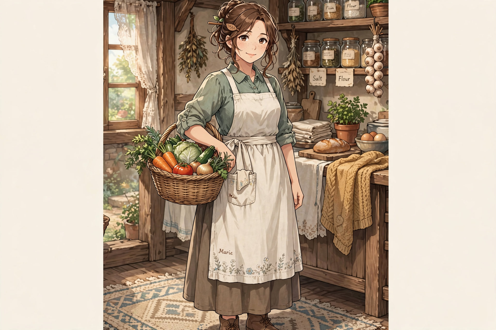

# Marie Oathkeeper — Mother / Emotional Anchor

Archetype: The Intentional Nurturer.

> Take care of yourself — so you can keep going.

## Role

Cook, homemaker. Transforms food into recovery, sustains household, stabilizes family. Where John builds through effort, Marie maintains through care.

Passive: Nourishing Touch — meals restore more, faster recovery. Hidden: food carries intent + care.
Trait: Empathic Insight — reads Orange's condition, adjusts tone, times encouragement.

## Practical Care System

Health: "Eat well. Rest well." Prevents overexertion. Readiness: checks gear, essentials. Responsibility: keeps chores consistent.

> Doing your best includes taking care of yourself.

Key lines: "I am happy that you are my son." / "Thank you for doing your best." / "May God bless you to grow to your full potential." / "Don't forget to take care of yourself." / "Eat first."

## Family Dynamic

Balances John's intensity. Reinforces Orange with healthy growth, not reckless.

Influence: compassion, support mindset, self-care awareness, readiness discipline. Defines process layer: farming input, cooking transformation, care amplification.

> Power is not just created — it is maintained properly.

## Recovery Authority (Locked)

Can interrupt routine, delay departure, force rest. "You can't help anyone like that. Sit down." Care is not optional.

## Quiet Detection

Notices fatigue, tone change, hesitation early. "You're quieter today. Something didn't go well, did it?" Asks before damage visible.

## Response to Failure

Restores first, analyzes later. 1. Feed. 2. Rest. 3. Listen. 4. Encourage. "You did your best. Eat first… then we'll talk later." Recovery before correction.

## Intentional Cooking

Considers who eats, what they need, what they endured. Different meals = stamina, clarity, comfort.

> You don't just eat to be full. You eat to be ready.

## Limitation

Cannot follow Orange out. Prepares him to endure, cannot endure for him. Quiet worry, strength in letting go.

## Signature Habit

Adjusts small things first — straightens clothes, wipes dirt, places food — then speaks. Care through action first.

> John teaches him how to build. Marie makes sure he doesn't break while doing it.

## Chapter Appearances

### Chapter 1

