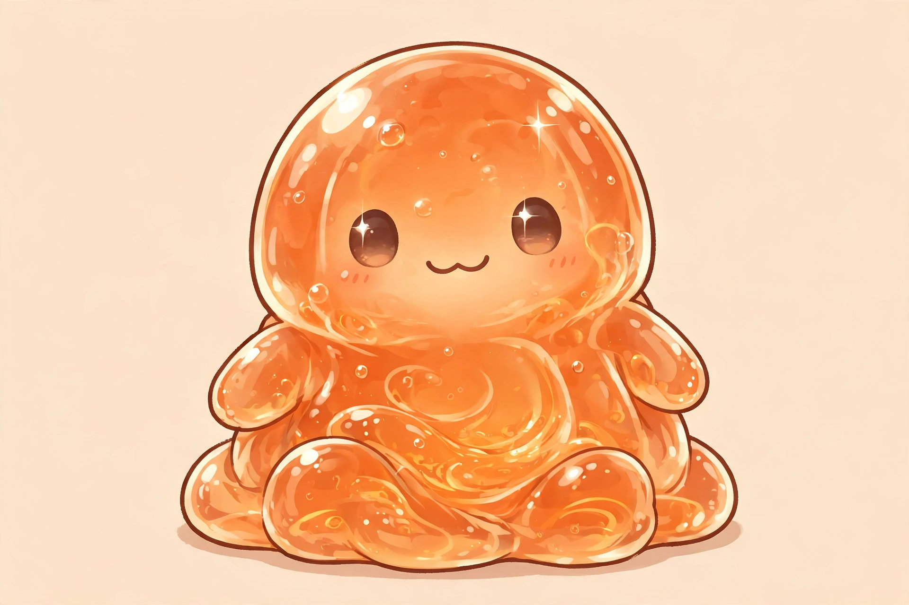

# Nochi — Slime Partner of Orange (Locked)

Nature: food-driven, loyal, supportive. Color: orange (locked). Plushie-ready mascot. Partner of [Orange Oathkeeper](../orange-oathkeeper.md).

## Personality (Locked)

Loves eating Orange's cooking. Stays close to Orange at all times. Motivated by: "If I help… I get fed more." Playful, loyal, slightly greedy in a cute way. (Name note: first called Smiley; named Nochi later.)

## SLIME DESIGN RULE (LOCKED)

Iconic slime form: classic droplet blob. May stretch semi-limb extensions, never humanoid in shape — no legs, no standing body.

## Evolution Path

1. Storage Core / Slime Battery — converts food into stored stamina energy + mana-like resource, slow release to attached character, transferable at will while attached. Orange cooks → slime eats → slime stores. This answers "where do buffs come from?" Sustains Orange in fights. Starts small (1 extra Heal scale), grows with level. Larger pool later for stronger enemies, never infinite.
2. Enhance Slime — boosts Orange skills (lights up, improves skills used).
3. Multiply — splits into small blobs, attaches to allies. Splits store, does not copy it. Later shares enhance.
4. Cocoon (Emergency) — full-body engulf, major heal/recovery for critical ally. Ultimate. SAS v1.1: calm companion beside Orange, stays close outside combat; left-hand conduit with subtle glow for healing, buffs, mana flow, storage only.

Toxin Processing (gated mid+): consumes poison with visible strain, then Orange heals the slime, slime processes toxin into antidote serum. Not instant. Requires time, mana, control. Fails if overloaded or interrupted. Identity: turn harm into remedy.

## Limitation Rule

Cannot create energy. Only stores, redistributes, enhances efficiency.

> Nochi extends sustainability — not power.

Overuse drains reserves. Mistimed release wastes energy. Eats a lot to give a lot. Efficient later.

> Nochi supports endurance, not instant victory. Buff moment can turn fight, not instant-win except vs very weak foe.

## Distribution Tiers (Locked)

PRIMARY FUNCTION: Distribution Support System. The slime becomes Orange's extension.

Early Stage: sticks to Orange, enhances his stamina and recovery.

Mid Stage — Slime Assist: sends small slime portions to allies for minor healing and stamina boost. Slime Beam (fun but controlled): short-range burst for emergency healing and quick support.

Advanced Stage — Replication Support: creates temporary support slimes that attach to teammates and supply buffs over time. The team becomes individually supported units.

## Visual Growth — Carrot Evolution (Locked)

Starts translucent, slowly turns orange-tinted. Diet-based evolution tied to Orange's cooking. The slime literally becomes "his."

## Nature Sync Mode (Locked, Late-Game)

Late evolution, not Volume 1. Nochi's absorption mastery — learned through Grow — extends past food: it also draws mana and nutrients from ambient surroundings. Activation: calm environment, focused state, Orange nearby. Effects: passive energy regeneration, stronger buff output, longer support duration.

Ruling: absorption is still storage, not creation — Nochi stores what it takes in, food or ambient. Cooking remains the strongest fuel by far. Ambient trickle only offsets idle drain until late mastery deepens it.

## Flavor Moments

Slime jumps excitedly when food is ready. Wraps around Orange when full. Hesitates before sharing energy — then does it anyway. Orange: "…You're not eating all of that." Slime: wiggles aggressively. Orange: "…Okay fine—but you help later."

## Narrative Function

Slimes become what they are exposed to. Nochi reflects nurtured area → cooperative. Early warning, environmental indicator, emotional mirror.

## Chapter Appearances

### Chapter 1

