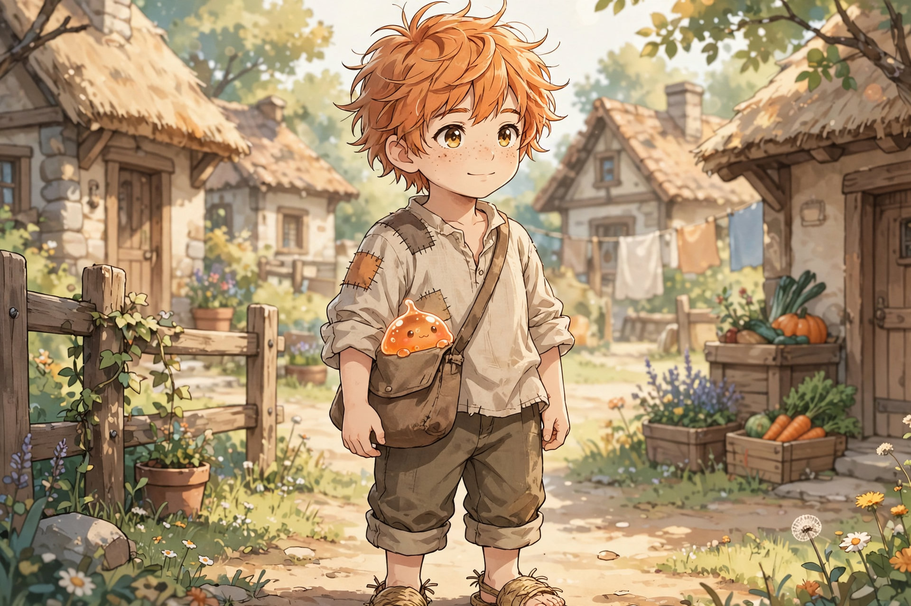
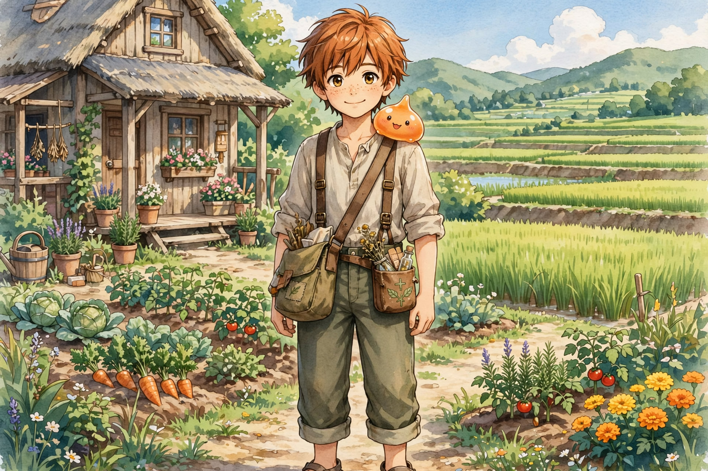

# Orange Oathkeeper — The Healer's Resolve

Role: Support Core / Growth Catalyst. Not strongest, fastest, or main damage. Makes everyone better.

Partner slime: [Nochi](nochi/nochi.md).

> He doesn't win the fight. He makes sure they can.

## Personality

Diligent, grounded, observant, quietly competitive. Watches before acting. Learns from mentors. Applies knowledge quickly.

Motivation: improve himself, support friends, prove proper practice leads to proper growth.

## Personality Lock (Foundation)

Core: kind, obedient, energetic, slightly boastful early (grows humble), emotionally honest, afraid sometimes.

Hidden: afraid of failing others, afraid of not being enough. Holds on because he knows he will break without help beyond himself.

Growth arc: 1. "I can do this!" (confidence) → 2. "I can't…" (breaking point) → 3. "Help me…" (surrender) → 4. "Use me." (purpose).

## Family

John Oathkeeper (farmer): work ethic, stamina, repetition mindset. Marie Oathkeeper (cook): care, nourishment awareness, patience.

## Passive — Regenerate (Locked)

Slow HP recovery, reduced fatigue, faster recovery. Hidden: allows more training reps than others. Still needs sleep, food, rest. Growth: Regenerate → Sustained Body → Endless Engine. Identity: "He doesn't stop." Supports healer path, cooking system, long-term scaling.

## Active Skills (Early)

- Heal / Cure — restores HP, removes minor status. Improves with growth.
- Status Up — temporary base stat increase.
- Grow (Core) — enhances efficiency, stability, effectiveness. Reduces waste, improves control, increases consistency. Not stronger fireball — straighter, cleaner, less waste. Effective damage up via efficiency, not raw power. Teammates training under Grow's duration master skills faster and can trigger Skill Evolution sooner — Team Orange is a powerhouse in the making, built on correct repetition, not shortcuts.
- Transform (Future) — ally ultimate state. High cost, situational.

> Orange does NOT increase power directly. He improves how power is USED.

## Path — Farm to Cook to Support

Farming builds strength and discipline. Cooking processes like his mom, gives buffs. Healing applies.

> Food ≠ Power. Process = Power.

## Cooking Support Path (Locked)

Updated identity: Healer + Sustainer + Harmonizer (was Healer + Support).

FUNCTIONAL COOKING: food as a support medium. Not instant magic, not potion spam — prepared, shared, sustained. Effects: gradual healing, stamina regeneration, buff amplification, mental stability.

Heal vs Cooking: Heal is instant, combat-use, mana-based, direct. Cooking is gradual, pre/post-combat, resource-based, shared.

Unique advantage — Buff Sharing: Orange's food affects multiple people at once, lasts longer, stacks with his healing.

Evolution: Early — "Mom's recipe" replication, slight stamina boost, better recovery after training. Mid — intent-based cooking ("This is for Leo" → endurance buff, "This is for Amy" → movement efficiency). Late — BATTLE MEAL / FIELD RATION SYSTEM: pre-battle buffs, team synergy boosts, sustained advantage over time.

Monster interaction: monsters respond to food — reduces hostility, builds trust. Orange doesn't tame monsters… he connects with them.

Balance: strengths are team sustain, long-fight advantage, social and monster bonding. Weaknesses: needs preparation, no burst power, depends on team.

Ember ending path: instead of "defeat the enemy," Orange allows "transform the enemy." Starving city, angry citizens, misguided leadership → he feeds people, stabilizes conflict, changes perception. War becomes unnecessary… or different. He creates sustainability, not just survival. Food supports team, monsters, even enemies — opening non-violent resolution paths.

## Internal Conflict (Locked)

Fear: "Even if I give everything… it still won't be enough." Pushes beyond limits, hesitates after failure, questions silently. Growth: doing everything he can is still meaningful even when outcome imperfect.

## Personal Anchor (Subtle Faith)

Quiet gratitude: before meals, after survival, in exhaustion. Short, sincere, not performative. Grounds heart, does not explain power.

Example: closes eyes, whispers thanks.

Dream System (rare guidance, locked): dreams come rarely, never every night, not always clear — sometimes symbolic, sometimes silent presence only, sometimes correction. Types: guidance, warning, formation, revelation. Tone stays mysterious but relational, never orders. Guidance never replaces training; power is still earned.

## Battle Authority (Locked)

In high pressure: calls priority targets, decides healing order, signals retreat or sustain. Highest awareness. Others fight better — Orange decides what matters most. Servant leader.

## Combat Role

Reads battle, positions safely, buffs agility for positioning, counter-attacks lightly. Reactive, timing-based, awareness-driven. Cannot out-damage attackers, out-tank Leo, out-speed Amy/Lyra. Relies on positioning.

> The team can fight without Orange… but cannot perform at best without him.

## Combat Identity Path (Gated)

Physical base → enhanced by healing → divine expression, late only.

Start: farm boy punches, grapples, endurance. Mid: self-healing tank, pushes beyond limits. Later: superhuman body, regeneration, shockwave punches and movement bursts. Endgame: body as vessel of divine will — rare, costly, never under his control, never instant victory.

Volume 1 rule: farm boy endurance plus basic healing only. No superhuman feats, no vessel moments.

## Growth Philosophy (Locked)

Orange becomes strong because: he works hard, learns properly (how AND why), is guided well, cares about others. NOT because of destiny, talent alone, or hidden power.

## Role in Team (Locked)

Orange is the stabilizer, the enabler, the backbone, partly strategist.

Team loop: Leo holds better to buy time, Amy flows to create openings, Lyra positions to land hits, Orange lasts to sustain all — then his actives multiply everything. Passives stay subtle, always-on, skill-based: anyone could develop them, few do. They scale naturally and never overshadow actives.

## Final Role (Locked Hard)

Heroic Support Anchor. He is not less of a fighter — he can fight, can survive, but is not the main damage dealer. Without him the team drops in performance.

Real power is AMPLIFICATION: he makes Leo stronger, Amy faster, Lyra sharper. He turns a good team into a GREAT team. Servant Leader core: feeds others, supports others, empowers others — but still stands in battle when needed.

## Final Lock Statement

> Orange Oathkeeper is not built to stand above others— he is built to raise others with him.

## Passive Origin (Locked)

Regenerate: Father → endurance. Mother → recovery. Result: a body that recovers and continues.

## Name Symbolism (Locked)

Oathkeeper: Orange doesn't just heal. He keeps people alive, supports teammates, follows through in battle. He keeps the team's "oath" to survive and win. Later themes: keeping promises to protect others, responsibility of power, not abandoning allies.

## Final Lock Summary

John Oathkeeper — farming, endurance, discipline. Marie Oathkeeper — cooking, nourishment, care. Orange Oathkeeper — regenerate, healer → buffer → system core.

## Legacy Rule (Locked)

Orange is not special because of birth. He is special because of process, discipline, and environment.

In theory anyone can reach his level. In reality almost no one — it requires consistent daily hard work, proper guidance (mentors like Serra and Edward), Ylila's balance of life and danger, correct heart and intent (serving others, not exploiting power), and multi-discipline exposure (farming + cooking + healing). Missing even one drastically lowers the ceiling.

Second generation advantage: Orange's future children (and disciples) get his methods from birth, refined techniques, and a stronger baseline environment. Higher potential ceiling — NOT guaranteed strength. They still need discipline, effort, and personal growth.

Legacy system: Generation 1 discovers and proves the path. Generation 2 inherits knowledge and pushes limits further. Generation 3 sees farm-cook-support recognized as a legitimate path — inns improve food systems, villages value farming, support roles gain respect, teams rely on non-combat strength. He doesn't just grow stronger. He changes the world's meta.

> "People think it's talent… But I've seen him. It's not talent. It's how he lives."

## New Core Law — Evolution Trigger (Locked)

Origin shift (FINAL): SAS is not accidental slime evolution. SAS is food-triggered evolution.

Orange's food does not just buff or heal. It triggers adaptation — it carries a "growth signal." Anyone (or anything) that eats his food consistently, bonds with him, and fights alongside him begins to evolve differently. Example: Leo eats, fights repeatedly, slime bonds → slime becomes smarter, armor becomes compatible, body adapts to both.

SAS redefined (FINAL): Symbiotic Adaptation System — living beings + external tools evolving together through sustained support. Growth = earned through relationship + consistency. The team grows because they stay together.

Catchphrase (LOCK): "…Maybe it's because of the food." Used casually, repeatedly, never fully explained early. Later a recognized phenomenon.

Enemy risk answer: enemies WILL find out and target, capture, or replicate. They fail — because it requires intent, care, consistency, relationship. It cannot be mass-produced. Power that cannot be stolen, power that must be shared.

Mentor effect: mentors benefit too and realize "something about this kid…" — Xavier (sharper mana control, longer endurance; would risk his life just to keep eating Orange's cooking — loyalty through benefit, then through bond), Serra (healing efficiency, stamina management), Elinore (sharper perception, faster recovery), Edward (sustained presence, longer morale boost).

Generation theme: mentors are the peak of their era, but Orange's team grows faster and evolves differently — they become the next generation's leaders. Because of one support core.

Final identity (LOCK HARD): not the strongest fighter, not the flashiest hero. He is the one who makes everyone else stronger. Early: good support. Mid: important support. Late: "We cannot win without him."

## Profile (Locked)

Basic info: Orange Oathkeeper, age 12 (birthday January 19), male, Human. Healer (Support → Hybrid future).

Main-story age lock: 12 (birthday January 19). Flashbacks at 8–10 only.

Personality: calm and dependable. Hidden: carries quiet pressure to always help others. Quirk: overworks without realizing it, says "I'm fine" even when tired.

Motivation: become someone people can rely on — no matter the situation.

Relationships: Leonard — best friend, friendly rivalry, trusts him completely. Amy — unaware of her feelings, treats her kindly and equally. Lyra — respects her awareness, relies on her judgment.

Weaknesses: too willing to help anyone, can be taken advantage of, doesn't prioritize himself.

Role in group: healer, buffer, stabilizer — the one who keeps everyone going.

Sample lines: "I'm okay… really. Let me help you first." / "If you can still stand, then we're not done yet."

Internal core — WANT: to protect and support everyone. NEED: to learn he can't save everyone, and must choose wisely. FEAR: someone gets hurt because he wasn't enough. FALSE BELIEF: "If I try hard enough, I can help everyone." Arc: starts helpful, selfless, naive → ends strong, wise, selective — helps with purpose, not impulse.

## Chapter Appearances

### Chapter 1

### Chapter 2 — Party Intro

