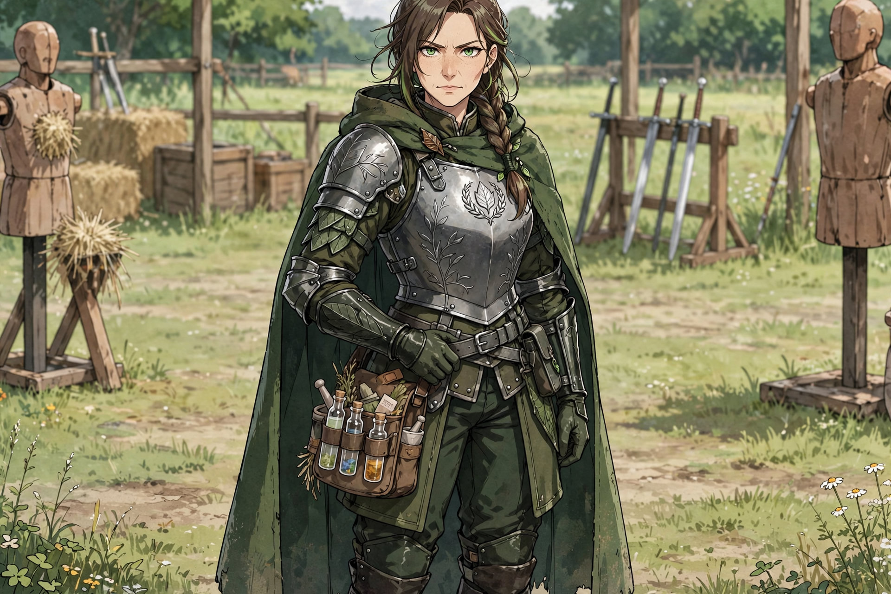

# Serra — The Wild Healer / Verdant Paladin

Role: Mentor / Combat Instructor / Decision Enforcer. Archetype: Unorthodox Master.

> If you can't survive… you can't heal.

## Class

Verdant Paladin: frontline-capable healer, buffer, efficient combatant. Sustained presence, not burst.

Personality: direct, blunt, observant, practical. Values results, corrects immediately.

Skills: controlled precise healing, Status Up to prevent collapse, minimal-movement survival combat.

## Philosophy

> Healing is not comfort. Healing is responsibility.

If someone falls → failed timing. If someone breaks → failed judgment.

Teaching: pressure, real scenarios, forced decisions. Push to limit, force decision, observe, correct, repeat.

Key lines: "You're not tired. You're honest." / "That's not your limit." / "Heal." / "Choose." / "Now."

## Core Lesson

Tactical Healing + Triage + Buff Timing (not growth-based healing).

Triage: who is critical, stable, needs boost. Priority: prevent failure, maintain frontline, enable win.

Grow used to turn fight when teammate can impact. Rule: don't just heal damage — prevent failure before it happens.

## Philosophical Conflict (Locked)

Orange: "If I do my best, that is enough." Serra: "Your best doesn't save people." Effort vs outcome. She has seen combat; parents are civilians.

Controlled failure training: allows failure to expose hesitation, teach consequence. "You remember failure more than success."

Emotional edge: care through correction, standards not softness. "Again. You can do better than that."

Presence: calm stabilizes field. "Think. Then act."

Limitation accepted: moves on faster than Orange, prioritizes living. Has crossed line Orange fears. Can appear cold.

Trust signal: rare praise — "Good." / "That was correct." / "Again." Weight because rare.

> Nature doesn't grow gently. It grows… because it must.

John builds foundation. Marie sustains. Serra forces him to become more. Teaches how to use power correctly.

## Chapter Appearances

### Chapter 1

