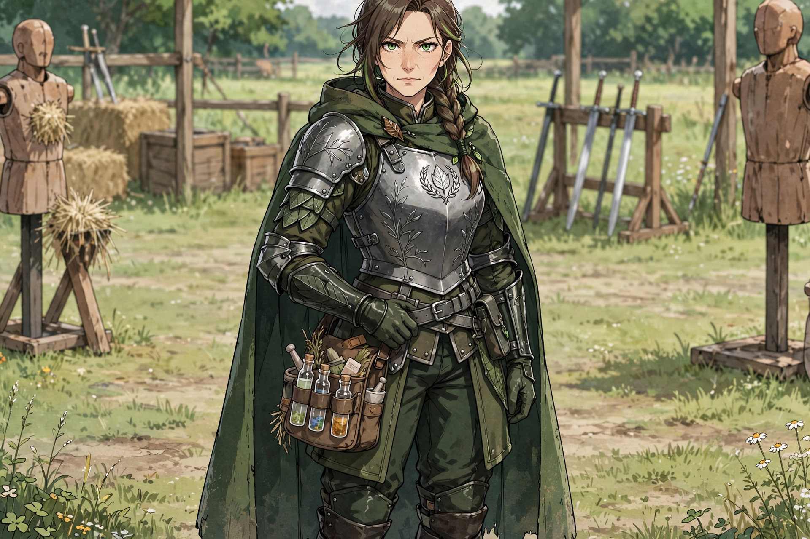
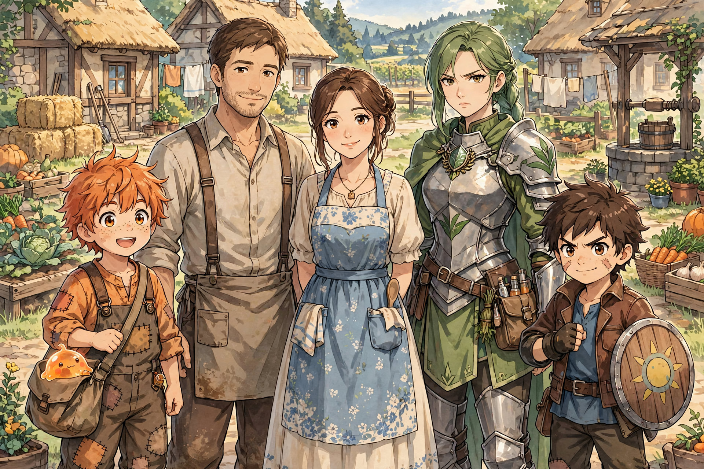

# Serra Valebloom — Paladin of the Dawn

Role: Mentor / Combat Instructor / Decision Enforcer. Archetype: Unorthodox Master.

> If you can't survive… you can't heal.

## Class

Paladin of the Dawn: frontline-capable healer, buffer, efficient combatant. Sustained presence, not burst. Verdant doctrine: life-aligned mana — sustain, reinforce, stabilize. Verdant means life, growth, and restoration flow, not plant magic. (Visual ban stays: no leaf armor, no herbalist styling.) Stat bias: VIT to outlast, INT for healing power and pool, DEX for casting control. Low burst damage, no speed-fighter agility.

Personality: direct, blunt, observant, practical. Values results, corrects immediately.

Skills: controlled precise healing, Status Up to prevent collapse, minimal-movement survival combat. Veteran capacity: layers up to five buffs at once (Speed, Strength, Endurance, Clarity, Focus); stamina holds from near-unending training. Orange may reach this in later volumes.

Signature skills (locked): Verdant Pulse (short-range multi-ally healing wave; reliable over strong); Rooted Guard (stance lock; less knockback, more resistance); Bloom Recovery (healing over time; stronger on resting targets); Life Link, advanced (shares damage and healing with one ally — carries triage weight); Verdant Surge, limited (brief vitality and recovery boost; fight-saving, never flashy).

Limits (locked): no burst heal, low damage, overwhelmed by many targets, must choose priorities.

## Philosophy

> Healing is not comfort. Healing is responsibility.

If someone falls → failed timing. If someone breaks → failed judgment.

Teaching: pressure, real scenarios, forced decisions. Push to limit, force decision, observe, correct, repeat.

Key lines: "You're not tired. You're honest." / "That's not your limit." / "Heal." / "Choose." / "Now."

## Core Lesson

Tactical Healing + Triage + Buff Timing (not growth-based healing).

Triage: who is critical, stable, needs boost. Priority: prevent failure, maintain frontline, enable win.

Grow used to turn fight when teammate can impact. Rule: don't just heal damage — prevent failure before it happens.

## Philosophical Conflict (Locked)

Orange: "If I do my best, that is enough." Serra: "Your best doesn't save people." Effort vs outcome. She has seen combat; parents are civilians.

Controlled failure training: allows failure to expose hesitation, teach consequence. "You remember failure more than success."

Emotional edge: care through correction, standards not softness. "Again. You can do better than that."

Presence: calm stabilizes field. "Think. Then act."

Limitation accepted: moves on faster than Orange, prioritizes living. Has crossed line Orange fears. Can appear cold.

Trust signal: rare praise — "Good." / "That was correct." / "Again." Weight because rare.

> Nature doesn't grow gently. It grows… because it must.

John builds foundation. Marie sustains. Serra forces him to become more. Teaches how to use power correctly.

## Past (Locked)

Former farmer — her brutal "farming" training comes from her own past: soil, water, labor, then heal yourself to your limit. Led a rescue-and-escort party from the mid post, not the backline: healing, buffing, fighting up front, and commanding. Perception and battle skills made her the team's core. Odd to traditional parties, exactly why Edward chose her for a farmer's boy. Training creed: if you can work and not get tired, that is not enough — do more, open your potential, surrender everything for your purpose.

Her creed (locked): stand so others won't fall; lift, don't crush; guide, don't control; protect even when it costs you. Plant the seed, water and tend it — only God makes it grow.

On the name (locked): called Wild Healer not for temperament — she is composed and stable — but for role-breaking: support magic overextended into attacks plus a commanding role no healer takes.

## Chapter Appearances

### Chapter 1

