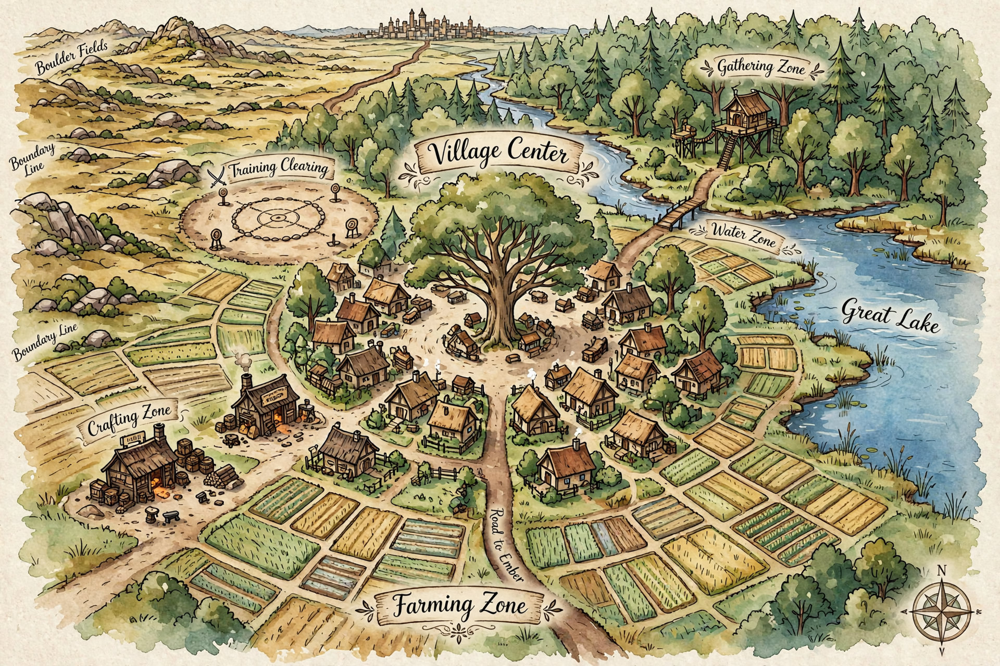

# YLILA VILLAGE — MAP SYSTEM (FINAL LOCK, REFINED)

**Type:** Early World Zone / Growth Environment
**Theme:** Balance of Life, Work, and Hidden Danger

---

## CORE CONCEPT

Ylila is not just a village. It is a training ground disguised as ordinary life.

✔ harsh land
✔ limited resources
✔ hidden threats beyond its borders

> “It looks peaceful…
> until you step too far.”

---

## SPATIAL OVERVIEW (IMPORTANT)

Orientation:

* North / Northeast → Forest / Gathering Zone
* East → Great Lake
* West → Crafting Zone / Plains
* South → Road to Ember
* Center → Village Core

Flow Design: Center → Work → Edge → Danger.

Natural progression: Safety → Responsibility → Risk → Survival.

---

## 1. FARMING ZONE (PRIMARY LIFE RING)

Location: surrounds most of the village (except the eastern lake side).

Description: difficult soil, requires constant effort, improved through John Oathkeeper's mastery.

Key Detail: farmer's storage area → southeast of village center, near the Oathkeeper residence.

Function: food production, stamina building, discipline training.

System Effect: builds endurance, reinforces repetition mindset.

---

## 2. RESIDENTIAL ZONE (INNER RING)

Location: surrounds the village center.

Description: clustered homes, family-centered living.

Function: emotional grounding, identity formation.

Key Homes:

* Orange's Home → recovery, cooking (Marie)
* Amy's Home → blade + food preparation
* Leo's Home → crafting influence
* Lyra's Home → stealth + bow mastery

---

## 3. VILLAGE CENTER (CORE HUB)

Description: large central tree, open gathering space.

Structures:

✔ Chief Edward's residence (Tank-Bard)
✔ Small Adventurer's Guild
✔ Village Well (east side)
✔ Marie's Food Stall (southeast)
✔ Tool Shops (north side)

Function: coordination, community interaction, decision-making hub.

This is where plans are made— not where battles are fought.

---

## 4. TRAINING CLEARING

Location: northwest side. Managed by Chief Edward.

Description: open dirt field, hand-drawn sparring circle.

Equipment: wooden short swords + shields (5 sets), bows with padded arrows (2 sets), crafted by Arroway family.

Function: combat fundamentals, team coordination, controlled conflict.

Rule: "Same rules?" — hit = point, stay inside, anything goes.

---

## 5. GATHERING ZONE (OUTER RING — NORTH/NORTHEAST)

Description: forest edge, herbs, berries, materials, occasional low-tier monsters.

Key Feature: Arroway Treehouse Outpost.

Function: stealth training, terrain mastery, awareness development.

Key Users: Lyra, Silk Arroway.

---

## 6. CRAFTING ZONE

Location: West → Blacksmith (Leo's family). North → Carpentry + Tailoring (Arroway family).

Description: workshops and toolmaking areas.

Function: gear creation, experimentation, optimization mindset.

Key Users: Leo (engineering mindset), Ethan (blacksmith), Nathaly (design).

---

## 7. WATER ZONE

Location: river flows from north forest → east lake.

Description: fishing area, docking space, recreational use. Near Amy's home.

Function: precision training, patience, controlled movement.

Key Users: Steve (father), Amy (knife precision).

---

## 8. BOUNDARY LINE (CRITICAL ZONE)

Description: no walls. Marked by soil shift, silence, tension.

Rule: "Villagers don't cross it."

Function: psychological barrier, first exposure to danger, decision checkpoint.

---

## 9. OUTER WILD ZONE (DANGER AREA)

Description: uncontrolled environment beyond the boundary.

Regions: North Forest → low-tier monsters. Far West Plains → leads to Boulder Fields (Golems). Acts as natural border to other nations.

Contains: slimes, beasts, evolving threats.

Function: real combat, fear response, decision-making under pressure.

---

## 10. ROAD TO EMBER

Location: south of the village. Dirt road, main connection to the outside world.

Usage: trade (rare surplus), travel to Ember.

Economic Detail: Ylila lacks natural metal resources, relies on trade and recycling.

---

## SYSTEM DESIGN (LOCKED)

Ylila is designed to: build fundamentals first, introduce danger gradually, reward discipline.

CORE RULE:

> ❗ Ylila does NOT create heroes. ✔ It prepares them to become one.

---

## BALANCE SYSTEM

Inside Ylila: safety, structure, growth.

Outside Ylila: danger, unpredictability, survival pressure.

---

## CHARACTER–ZONE LINK (IMPORTANT)

Each character is shaped by their environment:

* Orange → Farming + Home
* Amy → Water + Training + Home
* Leo → Crafting + Training
* Lyra → Gathering + Boundary

---

## FINAL LOCK STATEMENT

Ylila is not weak. It is quiet, disciplined, prepared.

> “They didn't grow strong in battle… they grew strong before it.”

## SURROUNDINGS — REGION MAP (FINAL LOCK)

NORTH — Forest → Mountains: immediately north is Forest Edge, far north the Mountain Range. Natural system: mountains drain water, rivers flow Mountains → Forest → Great Lake. Creates natural irrigation, fertile farmland, believable ecosystem.

EAST — Great Lake (~40x Ylila): fishing (Amy's family), water supply, calm emotional scenes. Also a natural boundary and future expansion zone.

SOUTH — Road to Ember: dirt road, grasslands, rolling hills, leads to Ember City. Trade route, danger route, invasion path (VERY IMPORTANT).

WEST — Plains of Danger: open plains, grasslands. Hidden threats: B-Tier Rock Golems, A-Rank Crystal Golem (territorial). Almost impossible to cross safely — a natural wall to the western noble cities. No artificial borders needed; the world blocks itself.

Built-in story structure: North → exploration, East → peace and bonding, South → conflict, West → high danger and late game. Layered progression: village life → clearing → forest → river → deeper zones; road → Ember → war; plains → late-game threat.

**END MAP SYSTEM**
